## Skill Hierarchy

```mermaid
graph TD
  generic-qcable --> quantum-cryogenic-cable
  generic-qcable --> mantaro
  generic-qcable --> polar
  generic-qcable --> component-integration
  generic-qcable --> connector
  generic-qcable --> crosstalk-calc
  generic-qcable --> three-view
  generic-qcable --> material-db
  generic-qcable --> thermal-load-measurement
  generic-qcable --> thermal-load-simulation
  generic-qcable --> thermal-load-units
  generic-qcable --> thermal-load-sop
  generic-qcable --> electrical-spec
  generic-qcable --> electrical-test-sop
  generic-qcable --> llm-parser
  generic-qcable --> measurement-unit-link
  quantum-cryogenic-cable --> mantaro
  quantum-cryogenic-cable --> polar
  quantum-cryogenic-cable --> nbtii-small-batch
  quantum-cryogenic-cable --> component-integration
  component-integration --> connector
  nbtii-small-batch --> nbtii-pcb-fab
  nbtii-small-batch --> nbtii-test-sop
  nbtii-pcb-fab --> nbtii-medium-batch
  nbtii-medium-batch --> nbtii-r2r-mass
  thermal-load-measurement --> thermal-load-simulation
  thermal-load-measurement --> thermal-load-sop
  thermal-load-simulation --> thermal-load-units
  engineering-delivery --> kpi-delivery-valid
  engineering-delivery --> cloud-deploy
  engineering-delivery --> skill-generator
  engineering-delivery --> refactor
  kpi-delivery-valid --> llm-parser
  kpi-delivery-valid --> measurement-unit-link
  qcable-index --> generic-qcable
  qcable-index --> quantum-cryogenic-cable
  qcable-index --> thermal-load-measurement
  qcable-index --> thermal-load-simulation
  qcable-index --> thermal-load-units
  qcable-index --> thermal-load-sop
  qcable-index --> component-integration
  qcable-index --> connector
  qcable-index --> crosstalk-calc
  qcable-index --> electrical-spec
  qcable-index --> electrical-test-sop
  qcable-index --> nbtii-small-batch
  qcable-index --> nbtii-pcb-fab
  qcable-index --> nbtii-medium-batch
  qcable-index --> nbtii-r2r-mass
  qcable-index --> nbtii-test-sop
  qcable-index --> mantaro
  qcable-index --> polar
  qcable-index --> llm-parser
  qcable-index --> measurement-unit-link
  qcable-index --> skill-generator
  qcable-index --> refactor
  qcable-index --> cloud-deploy
  qcable-index --> material-db
  qcable-index --> three-view
  qcable-index --> oloid-3d-product
  qcable-index --> txt-proc
  qcable-index --> txt-genoffice
  qcable-index --> engineering-delivery
  qcable-index --> kpi-delivery-valid
```


## Repo Import Graph
```mermaid
graph TD
  代理主程式 --> copy
  代理主程式 --> 全域狀態
  代理主程式 --> 計算
  LLM解析 --> re
  本地端LLM --> json
  本地端LLM --> math
  本地端LLM --> openai
  本地端LLM --> streamlit
  定時II --> json
  定時II --> numpy
  定時II --> pandas
  定時II --> sys
  疊構Util --> numpy
  疊構Util --> pandas
  疊構Util --> streamlit
  三視圖 --> math
  三視圖 --> matplotlib
  計算 --> math
  計算 --> numpy
  ast_scanner --> 掃瞄器
  定時 --> json
  定時 --> numpy
  定時 --> pandas
  定時 --> sys
  定時 --> 計算
  左入右出S4P引擎 --> numpy
  圖閉環 --> json
  圖閉環 --> langchain_anthropic
  圖閉環 --> langchain_core
  圖閉環 --> langchain_mcp_adapters
  圖閉環 --> langgraph
  圖閉環 --> os
  圖閉環 --> re
  圖閉環 --> typing
  圖閉環 --> typing_extensions
  元件整合 --> math
  元件整合 --> numpy
  規範自動判定 --> plotly
  規範自動判定 --> streamlit
  orchestrator --> argparse
  orchestrator --> json
  orchestrator --> openai
  orchestrator --> os
  orchestrator --> sys
  全域狀態 --> typing
  app --> streamlit
  技能產生器主程式 --> ast_scanner
  技能產生器主程式 --> json
  掃瞄器 --> ast
  掃瞄器 --> json
  掃瞄器 --> os
  決策節點 --> re
  決策節點與優化 --> langgraph
  技能產生器驗證 --> generated_skills
  技能產生器驗證 --> pytest
  串擾計算 --> math
  acceptance_pipeline.test_runner --> dataclasses
  acceptance_pipeline.test_runner --> json
  acceptance_pipeline.test_runner --> os
  acceptance_pipeline.test_runner --> shutil
  acceptance_pipeline.test_runner --> subprocess
  acceptance_pipeline.test_runner --> sys
  acceptance_pipeline.test_runner --> typing
  acceptance_pipeline.kpi_spec --> dataclasses
  acceptance_pipeline.kpi_spec --> json
  acceptance_pipeline.kpi_spec --> os
  acceptance_pipeline.kpi_spec --> typing
  acceptance_pipeline.pipeline --> dataclasses
  acceptance_pipeline.pipeline --> json
  acceptance_pipeline.pipeline --> os
  acceptance_pipeline.pipeline --> sys
  acceptance_pipeline.pipeline --> time
  acceptance_pipeline.pipeline --> typing
  acceptance_pipeline.measurement_link --> typing
  acceptance_pipeline.usage_generator --> os
  acceptance_pipeline.usage_generator --> typing
  acceptance_pipeline.material_db --> json
  acceptance_pipeline.material_db --> os
  acceptance_pipeline.material_db --> typing
  acceptance_pipeline.material_db --> warnings
  acceptance_pipeline.deliverables --> hashlib
  acceptance_pipeline.deliverables --> json
  acceptance_pipeline.deliverables --> os
  acceptance_pipeline.deliverables --> shutil
  acceptance_pipeline.deliverables --> typing
  acceptance_pipeline.meeting_tracker --> datetime
  acceptance_pipeline.meeting_tracker --> json
  acceptance_pipeline.meeting_tracker --> os
  acceptance_pipeline.meeting_tracker --> typing
  acceptance_pipeline.stages --> dataclasses
  acceptance_pipeline.stages --> os
  acceptance_pipeline.stages --> sys
  acceptance_pipeline.stages --> time
  acceptance_pipeline.stages --> traceback
  acceptance_pipeline.stages --> typing
  acceptance_pipeline.acceptance_criteria --> dataclasses
  acceptance_pipeline.acceptance_criteria --> json
  acceptance_pipeline.acceptance_criteria --> os
  acceptance_pipeline.acceptance_criteria --> typing
  acceptance_pipeline.report --> json
  acceptance_pipeline.report --> os
  acceptance_pipeline.report --> typing
  colibri.c.v41_dsml --> json
  colibri.c.v41_dsml --> re
  colibri.c.v41_dsml --> sys
  colibri.c.v41_dsml --> uuid
  colibri.c.resource_plan --> family_registry
  colibri.c.resource_plan --> json
  colibri.c.resource_plan --> os
  colibri.c.resource_plan --> pathlib
  colibri.c.resource_plan --> platform
  colibri.c.resource_plan --> re
  colibri.c.resource_plan --> shutil
  colibri.c.resource_plan --> statistics
  colibri.c.resource_plan --> subprocess
  colibri.c.resource_plan --> sys
  colibri.c.resource_plan --> threading
  colibri.c.v4_dsml --> json
  colibri.c.v4_dsml --> re
  colibri.c.v4_dsml --> sys
  colibri.c.v4_dsml --> uuid
  colibri.c.openai_server --> argparse
  colibri.c.openai_server --> codecs
  colibri.c.openai_server --> collections
  colibri.c.openai_server --> contextlib
  colibri.c.openai_server --> family_registry
  colibri.c.openai_server --> hashlib
  colibri.c.openai_server --> http
  colibri.c.openai_server --> json
  colibri.c.openai_server --> math
  colibri.c.openai_server --> mimetypes
  colibri.c.openai_server --> os
  colibri.c.openai_server --> pathlib
  colibri.c.openai_server --> queue
  colibri.c.openai_server --> re
  colibri.c.openai_server --> select
  colibri.c.openai_server --> signal
  colibri.c.openai_server --> socket
  colibri.c.openai_server --> subprocess
  colibri.c.openai_server --> sys
  colibri.c.openai_server --> threading
  colibri.c.openai_server --> time
  colibri.c.openai_server --> urllib
  colibri.c.openai_server --> uuid
  colibri.c.openai_server --> v41_dsml
  colibri.c.openai_server --> v4_dsml
  colibri.c.download_fp8 --> os
  colibri.c.cluster --> argparse
  colibri.c.cluster --> http
  colibri.c.cluster --> json
  colibri.c.cluster --> openai_server
  colibri.c.cluster --> os
  colibri.c.cluster --> sys
  colibri.c.cluster --> threading
  colibri.c.cluster --> time
  colibri.c.cluster --> urllib
  colibri.c.experiment_manifest --> __future__
  colibri.c.experiment_manifest --> argparse
  colibri.c.experiment_manifest --> json
  colibri.c.experiment_manifest --> math
  colibri.c.experiment_manifest --> pathlib
  colibri.c.experiment_manifest --> statistics
  colibri.c.doctor --> family_registry
  colibri.c.doctor --> json
  colibri.c.doctor --> os
  colibri.c.doctor --> pathlib
  colibri.c.doctor --> re
  colibri.c.doctor --> resource_plan
  colibri.c.doctor --> subprocess
  colibri.c.doctor --> sys
  colibri.c.family_registry --> dataclasses
  colibri.c.family_registry --> json
  colibri.c.family_registry --> math
  colibri.c.family_registry --> os
  colibri.c.family_registry --> pathlib
  colibri.c.family_registry --> re
  colibri.c.autotune --> __future__
  colibri.c.autotune --> hashlib
  colibri.c.autotune --> json
  colibri.c.autotune --> math
  colibri.c.autotune --> os
  colibri.c.autotune --> pathlib
  colibri.c.autotune --> platform
  colibri.c.autotune --> re
  colibri.c.autotune --> statistics
  colibri.c.autotune --> subprocess
  colibri.c.autotune --> sys
  colibri.c.autotune --> tempfile
  colibri.c.autotune --> time
  colibri.c.tools.benchmark_baseline --> argparse
  colibri.c.tools.benchmark_baseline --> datetime
  colibri.c.tools.benchmark_baseline --> hashlib
  colibri.c.tools.benchmark_baseline --> json
  colibri.c.tools.benchmark_baseline --> math
  colibri.c.tools.benchmark_baseline --> os
  colibri.c.tools.benchmark_baseline --> pathlib
  colibri.c.tools.benchmark_baseline --> statistics
  colibri.c.tools.make_deepseek_v4_tiny --> __future__
  colibri.c.tools.make_deepseek_v4_tiny --> argparse
  colibri.c.tools.make_deepseek_v4_tiny --> collections
  colibri.c.tools.make_deepseek_v4_tiny --> json
  colibri.c.tools.make_deepseek_v4_tiny --> math
  colibri.c.tools.make_deepseek_v4_tiny --> pathlib
  colibri.c.tools.make_deepseek_v4_tiny --> shutil
  colibri.c.tools.make_deepseek_v4_tiny --> struct
  colibri.c.tools.make_e8_fixture --> iq3_pack
  colibri.c.tools.make_e8_fixture --> numpy
  colibri.c.tools.make_e8_fixture --> os
  colibri.c.tools.make_e8_fixture --> struct
  colibri.c.tools.make_e8_fixture --> the
  colibri.c.tools.repack_fp8_passthrough --> argparse
  colibri.c.tools.repack_fp8_passthrough --> convert_fp8_to_int4
  colibri.c.tools.repack_fp8_passthrough --> the
  colibri.c.tools.convert_fp8_to_int4 --> numpy
  colibri.c.tools.convert_fp8_to_int4 --> os
  colibri.c.tools.dsv4_fc1_deepgemm_oracle --> json
  colibri.c.tools.dsv4_fc1_deepgemm_oracle --> pathlib
  colibri.c.tools.dsv4_fc1_deepgemm_oracle --> safetensors
  colibri.c.tools.dsv4_fc1_deepgemm_oracle --> torch
  colibri.c.tools.dsv4_fc1_deepgemm_oracle --> vllm
  colibri.c.tools.rans_verify --> argparse
  colibri.c.tools.rans_verify --> hashlib
  colibri.c.tools.rans_verify --> json
  colibri.c.tools.rans_verify --> os
  colibri.c.tools.rans_verify --> rans_format
  colibri.c.tools.rans_verify --> sys
  colibri.c.tools.quant_ablation --> argparse
  colibri.c.tools.quant_ablation --> json
  colibri.c.tools.quant_ablation --> random
  colibri.c.tools.quant_ablation --> re
  colibri.c.tools.quant_ablation --> sys
  colibri.c.tools.quant_ablation --> torch
  colibri.c.tools.quant_ablation --> transformers
  colibri.c.tools.make_glm53_tokenizer --> __future__
  colibri.c.tools.make_glm53_tokenizer --> argparse
  colibri.c.tools.make_glm53_tokenizer --> json
  colibri.c.tools.make_glm53_tokenizer --> pathlib
  colibri.c.tools.make_glm53_multimodal_tiny --> __future__
  colibri.c.tools.make_glm53_multimodal_tiny --> argparse
  colibri.c.tools.make_glm53_multimodal_tiny --> contextlib
  colibri.c.tools.make_glm53_multimodal_tiny --> json
  colibri.c.tools.make_glm53_multimodal_tiny --> pathlib
  colibri.c.tools.make_glm53_multimodal_tiny --> sys
  colibri.c.tools.iq3_pack --> json
  colibri.c.tools.iq3_pack --> numpy
  colibri.c.tools.iq3_pack --> os
  colibri.c.tools.convert_inkling_int4 --> argparse
  colibri.c.tools.convert_inkling_int4 --> glob
  colibri.c.tools.convert_inkling_int4 --> json
  colibri.c.tools.convert_inkling_int4 --> numpy
  colibri.c.tools.convert_inkling_int4 --> os
  colibri.c.tools.convert_inkling_int4 --> re
  colibri.c.tools.convert_inkling_int4 --> safetensors
  colibri.c.tools.convert_inkling_int4 --> shutil
  colibri.c.tools.convert_inkling_int4 --> sys
  colibri.c.tools.convert_inkling_int4 --> time
  colibri.c.tools.convert_inkling_int4 --> torch
  colibri.c.tools.fetch_benchmarks --> os
  colibri.c.tools.make_kimi_k3_tiny --> argparse
  colibri.c.tools.make_kimi_k3_tiny --> json
  colibri.c.tools.make_kimi_k3_tiny --> numpy
  colibri.c.tools.make_kimi_k3_tiny --> pathlib
  colibri.c.tools.make_kimi_k3_tiny --> struct
  colibri.c.tools.make_kimi_k3_tiny --> sys
  colibri.c.tools.benchmark_serving_interference --> argparse
  colibri.c.tools.benchmark_serving_interference --> json
  colibri.c.tools.benchmark_serving_interference --> os
  colibri.c.tools.benchmark_serving_interference --> statistics
  colibri.c.tools.benchmark_serving_interference --> subprocess
  colibri.c.tools.benchmark_serving_interference --> sys
  colibri.c.tools.benchmark_serving_interference --> threading
  colibri.c.tools.benchmark_serving_interference --> time
  colibri.c.tools.try_tool_calling --> argparse
  colibri.c.tools.try_tool_calling --> json
  colibri.c.tools.try_tool_calling --> sys
  colibri.c.tools.try_tool_calling --> urllib
  colibri.c.tools.mirror_plan --> argparse
  colibri.c.tools.mirror_plan --> datetime
  colibri.c.tools.mirror_plan --> errno
  colibri.c.tools.mirror_plan --> fractions
  colibri.c.tools.mirror_plan --> hashlib
  colibri.c.tools.mirror_plan --> json
  colibri.c.tools.mirror_plan --> math
  colibri.c.tools.mirror_plan --> os
  colibri.c.tools.mirror_plan --> pathlib
  colibri.c.tools.mirror_plan --> re
  colibri.c.tools.mirror_plan --> shutil
  colibri.c.tools.mirror_plan --> struct
  colibri.c.tools.mirror_plan --> sys
  colibri.c.tools.k3_ref --> argparse
  colibri.c.tools.k3_ref --> json
  colibri.c.tools.k3_ref --> numpy
  colibri.c.tools.k3_ref --> os
  colibri.c.tools.k3_ref --> struct
  colibri.c.tools.k3_ref --> sys
  colibri.c.tools.dsv4_masked_moe_probe --> json
  colibri.c.tools.dsv4_masked_moe_probe --> os
  colibri.c.tools.dsv4_masked_moe_probe --> pathlib
  colibri.c.tools.dsv4_masked_moe_probe --> safetensors
  colibri.c.tools.dsv4_masked_moe_probe --> torch
  colibri.c.tools.dsv4_masked_moe_probe --> vllm
  colibri.c.tools.make_qwen38_oracle --> argparse
  colibri.c.tools.make_qwen38_oracle --> hashlib
  colibri.c.tools.make_qwen38_oracle --> json
  colibri.c.tools.make_qwen38_oracle --> pathlib
  colibri.c.tools.make_qwen38_oracle --> random
  colibri.c.tools.make_qwen38_oracle --> sys
  colibri.c.tools.convert_glm53 --> argparse
  colibri.c.tools.convert_glm53 --> json
  colibri.c.tools.convert_glm53 --> numpy
  colibri.c.tools.convert_glm53 --> os
  colibri.c.tools.convert_glm53 --> shutil
  colibri.c.tools.convert_glm53 --> sys
  colibri.c.tools.convert_glm53 --> time
  colibri.c.tools.datapoint --> argparse
  colibri.c.tools.datapoint --> os
  colibri.c.tools.datapoint --> pathlib
  colibri.c.tools.datapoint --> platform
  colibri.c.tools.datapoint --> re
  colibri.c.tools.datapoint --> shutil
  colibri.c.tools.datapoint --> statistics
  colibri.c.tools.datapoint --> subprocess
  colibri.c.tools.datapoint --> sys
  colibri.c.tools.datapoint --> tempfile
  colibri.c.tools.datapoint --> time
  colibri.c.tools.repair_mtp_int8 --> argparse
  colibri.c.tools.repair_mtp_int8 --> numpy
  colibri.c.tools.dsv4_mhc_oracle --> safetensors
  colibri.c.tools.dsv4_mhc_oracle --> struct
  colibri.c.tools.dsv4_mhc_oracle --> sys
  colibri.c.tools.dsv4_mhc_oracle --> torch
  colibri.c.tools.eval_glm --> argparse
  colibri.c.tools.eval_glm --> engine_evidence
  colibri.c.tools.eval_glm --> hashlib
  colibri.c.tools.eval_glm --> json
  colibri.c.tools.eval_glm --> math
  colibri.c.tools.eval_glm --> os
  colibri.c.tools.eval_glm --> random
  colibri.c.tools.eval_glm --> re
  colibri.c.tools.eval_glm --> signal
  colibri.c.tools.eval_glm --> subprocess
  colibri.c.tools.eval_glm --> sys
  colibri.c.tools.eval_glm --> tempfile
  colibri.c.tools.eval_glm --> threading
  colibri.c.tools.eval_glm --> time
  colibri.c.tools.make_glm53_tiny --> __future__
  colibri.c.tools.make_glm53_tiny --> argparse
  colibri.c.tools.make_glm53_tiny --> collections
  colibri.c.tools.make_glm53_tiny --> json
  colibri.c.tools.make_glm53_tiny --> pathlib
  colibri.c.tools.make_glm53_tiny --> shutil
  colibri.c.tools.make_glm53_tiny --> types
  colibri.c.tools.convert_qwen36 --> argparse
  colibri.c.tools.convert_qwen36 --> pathlib
  colibri.c.tools.convert_qwen36 --> qwen36_tensor_kinds
  colibri.c.tools.make_tiny_inkling --> json
  colibri.c.tools.make_tiny_inkling --> sys
  colibri.c.tools.make_tiny_inkling --> torch
  colibri.c.tools.convert_gguf_to_olmoe --> argparse
  colibri.c.tools.convert_gguf_to_olmoe --> gguf_dequant
  colibri.c.tools.convert_gguf_to_olmoe --> gguf_olmoe_profile
  colibri.c.tools.convert_gguf_to_olmoe --> gguf_reader
  colibri.c.tools.convert_gguf_to_olmoe --> json
  colibri.c.tools.convert_gguf_to_olmoe --> numpy
  colibri.c.tools.convert_gguf_to_olmoe --> os
  colibri.c.tools.convert_gguf_to_olmoe --> pathlib
  colibri.c.tools.convert_gguf_to_olmoe --> sys
  colibri.c.tools.convert_gguf_to_olmoe --> time
  colibri.c.tools.make_tiny_inkling_audio --> json
  colibri.c.tools.make_tiny_inkling_audio --> sys
  colibri.c.tools.make_tiny_inkling_audio --> torch
  colibri.c.tools.make_qwen38_multimodal_tiny --> __future__
  colibri.c.tools.make_qwen38_multimodal_tiny --> argparse
  colibri.c.tools.make_qwen38_multimodal_tiny --> json
  colibri.c.tools.make_qwen38_multimodal_tiny --> pathlib
  colibri.c.tools.dsv4_dense_deepgemm_probe --> json
  colibri.c.tools.dsv4_dense_deepgemm_probe --> os
  colibri.c.tools.dsv4_dense_deepgemm_probe --> pathlib
  colibri.c.tools.dsv4_dense_deepgemm_probe --> safetensors
  colibri.c.tools.dsv4_dense_deepgemm_probe --> torch
  colibri.c.tools.dsv4_dense_deepgemm_probe --> vllm
  colibri.c.tools.make_glm53_streaming_pair --> __future__
  colibri.c.tools.make_glm53_streaming_pair --> argparse
  colibri.c.tools.make_glm53_streaming_pair --> json
  colibri.c.tools.make_glm53_streaming_pair --> pathlib
  colibri.c.tools.make_glm53_streaming_pair --> shutil
  colibri.c.tools.dsv4_block_oracle --> json
  colibri.c.tools.dsv4_block_oracle --> safetensors
  colibri.c.tools.clean --> glob
  colibri.c.tools.clean --> os
  colibri.c.tools.clean --> shutil
  colibri.c.tools.rans_format --> base64
  colibri.c.tools.rans_format --> ctypes
  colibri.c.tools.rans_format --> hashlib
  colibri.c.tools.rans_format --> json
  colibri.c.tools.rans_format --> numpy
  colibri.c.tools.rans_format --> os
  colibri.c.tools.rans_format --> struct
  colibri.c.tools.rans_format --> zlib
  colibri.c.tools.route_coupling_report --> collections
  colibri.c.tools.route_coupling_report --> numpy
  colibri.c.tools.route_coupling_report --> sys
  colibri.c.tools.engine_evidence --> math
  colibri.c.tools.engine_evidence --> re
  colibri.c.tools.benchmark_continuous_batch --> argparse
  colibri.c.tools.benchmark_continuous_batch --> json
  colibri.c.tools.benchmark_continuous_batch --> os
  colibri.c.tools.benchmark_continuous_batch --> statistics
  colibri.c.tools.benchmark_continuous_batch --> subprocess
  colibri.c.tools.benchmark_continuous_batch --> sys
  colibri.c.tools.benchmark_continuous_batch --> threading
  colibri.c.tools.benchmark_continuous_batch --> time
  colibri.c.tools.run_tests --> os
  colibri.c.tools.run_tests --> subprocess
  colibri.c.tools.run_tests --> sys
  colibri.c.tools.k3_tokenizer --> argparse
  colibri.c.tools.k3_tokenizer --> base64
  colibri.c.tools.k3_tokenizer --> json
  colibri.c.tools.k3_tokenizer --> os
  colibri.c.tools.k3_tokenizer --> sys
  colibri.c.tools.k3_tokenizer --> tempfile
  colibri.c.tools.make_glm53_vision_tiny --> __future__
  colibri.c.tools.make_glm53_vision_tiny --> argparse
  colibri.c.tools.make_glm53_vision_tiny --> json
  colibri.c.tools.make_glm53_vision_tiny --> pathlib
  colibri.c.tools.make_glm_bench_model --> argparse
  colibri.c.tools.make_glm_bench_model --> glm_fp8_emit
  colibri.c.tools.make_glm_bench_model --> json
  colibri.c.tools.make_glm_bench_model --> pathlib
  colibri.c.tools.make_glm_bench_model --> sys
  colibri.c.tools.make_glm_bench_model --> torch
  colibri.c.tools.make_glm_bench_model --> transformers
  colibri.c.tools.make_qwen36_tiny --> argparse
  colibri.c.tools.make_qwen36_tiny --> pathlib
  colibri.c.tools.pack_python --> ast
  colibri.c.tools.pack_python --> pathlib
  colibri.c.tools.pack_python --> re
  colibri.c.tools.pack_python --> shutil
  colibri.c.tools.pack_python --> sys
  colibri.c.tools.prepare_dsv41 --> __future__
  colibri.c.tools.prepare_dsv41 --> argparse
  colibri.c.tools.prepare_dsv41 --> json
  colibri.c.tools.prepare_dsv41 --> pathlib
  colibri.c.tools.dsv4_vllm_reference --> argparse
  colibri.c.tools.dsv4_vllm_reference --> time
  colibri.c.tools.dsv4_vllm_reference --> vllm
  colibri.c.tools.fp8_collision_census --> glob
  colibri.c.tools.benchmark_kv_prefix --> argparse
  colibri.c.tools.benchmark_kv_prefix --> json
  colibri.c.tools.benchmark_kv_prefix --> os
  colibri.c.tools.benchmark_kv_prefix --> subprocess
  colibri.c.tools.benchmark_kv_prefix --> sys
  colibri.c.tools.benchmark_kv_prefix --> threading
  colibri.c.tools.benchmark_kv_prefix --> time
  colibri.c.tools.make_qwen36_oracle --> argparse
  colibri.c.tools.make_qwen36_oracle --> pathlib
  colibri.c.tools.convert_olmoe_merged --> argparse
  colibri.c.tools.convert_olmoe_merged --> os
  colibri.c.tools.convert_olmoe_merged --> pathlib
  colibri.c.tools.convert_olmoe_merged --> re
  colibri.c.tools.convert_olmoe_merged --> shutil
  colibri.c.tools.convert_olmoe_merged --> sys
  colibri.c.tools.download_glm52 --> huggingface_hub
  colibri.c.tools.download_glm52 --> os
  colibri.c.tools.gen_unicode --> sys
  colibri.c.tools.k3_repack --> argparse
  colibri.c.tools.k3_repack --> glob
  colibri.c.tools.k3_repack --> json
  colibri.c.tools.k3_repack --> numpy
  colibri.c.tools.k3_repack --> os
  colibri.c.tools.k3_repack --> shutil
  colibri.c.tools.k3_repack --> struct
  colibri.c.tools.k3_repack --> sys
  colibri.c.tools.k3_repack --> time
  colibri.c.tools.gguf_reader --> os
  colibri.c.tools.gguf_reader --> struct
  colibri.c.tools.convert_olmoe --> argparse
  colibri.c.tools.convert_olmoe --> pathlib
  colibri.c.tools.make_olmoe_real_oracle --> json
  colibri.c.tools.make_olmoe_real_oracle --> pathlib
  colibri.c.tools.make_olmoe_real_oracle --> sys
  colibri.c.tools.mw_ur3_raw_adapter --> __future__
  colibri.c.tools.mw_ur3_raw_adapter --> argparse
  colibri.c.tools.mw_ur3_raw_adapter --> collections
  colibri.c.tools.mw_ur3_raw_adapter --> hashlib
  colibri.c.tools.mw_ur3_raw_adapter --> io
  colibri.c.tools.mw_ur3_raw_adapter --> json
  colibri.c.tools.mw_ur3_raw_adapter --> math
  colibri.c.tools.mw_ur3_raw_adapter --> os
  colibri.c.tools.mw_ur3_raw_adapter --> pathlib
  colibri.c.tools.mw_ur3_raw_adapter --> re
  colibri.c.tools.mw_ur3_raw_adapter --> sys
  colibri.c.tools.benchmark_http_serving --> argparse
  colibri.c.tools.benchmark_http_serving --> concurrent
  colibri.c.tools.benchmark_http_serving --> hashlib
  colibri.c.tools.benchmark_http_serving --> json
  colibri.c.tools.benchmark_http_serving --> math
  colibri.c.tools.benchmark_http_serving --> os
  colibri.c.tools.benchmark_http_serving --> pathlib
  colibri.c.tools.benchmark_http_serving --> random
  colibri.c.tools.benchmark_http_serving --> time
  colibri.c.tools.benchmark_http_serving --> urllib
  colibri.c.tools.make_dsv41_tiny --> __future__
  colibri.c.tools.make_dsv41_tiny --> argparse
  colibri.c.tools.make_dsv41_tiny --> dsv41_ref
  colibri.c.tools.make_dsv41_tiny --> json
  colibri.c.tools.make_dsv41_tiny --> pathlib
  colibri.c.tools.make_dsv41_tiny --> safetensors
  colibri.c.tools.make_dsv41_tiny --> sys
  colibri.c.tools.make_dsv41_tiny --> torch
  colibri.c.tools.qwen38_image --> __future__
  colibri.c.tools.qwen38_image --> argparse
  colibri.c.tools.qwen38_image --> json
  colibri.c.tools.qwen38_image --> math
  colibri.c.tools.qwen38_image --> pathlib
  colibri.c.tools.qwen38_image --> sys
  colibri.c.tools.make_kimi_k3_ref --> argparse
  colibri.c.tools.make_kimi_k3_ref --> hashlib
  colibri.c.tools.make_kimi_k3_ref --> importlib
  colibri.c.tools.make_kimi_k3_ref --> json
  colibri.c.tools.make_kimi_k3_ref --> numpy
  colibri.c.tools.make_kimi_k3_ref --> pathlib
  colibri.c.tools.make_kimi_k3_ref --> struct
  colibri.c.tools.make_kimi_k3_ref --> sys
  colibri.c.tools.make_kimi_k3_ref --> urllib
  colibri.c.tools.gguf_dequant --> gguf_reader
  colibri.c.tools.gguf_dequant --> numpy
  colibri.c.tools.gen_qwen38_nfc --> __future__
  colibri.c.tools.gen_qwen38_nfc --> argparse
  colibri.c.tools.gen_qwen38_nfc --> pathlib
  colibri.c.tools.gen_qwen38_nfc --> unicodedata
  colibri.c.tools.dsv41_image --> __future__
  colibri.c.tools.dsv41_image --> io
  colibri.c.tools.dsv41_image --> json
  colibri.c.tools.dsv41_image --> math
  colibri.c.tools.dsv41_image --> pathlib
  colibri.c.tools.analyze_split_entropy --> argparse
  colibri.c.tools.analyze_split_entropy --> glob
  colibri.c.tools.analyze_split_entropy --> json
  colibri.c.tools.analyze_split_entropy --> math
  colibri.c.tools.analyze_split_entropy --> numpy
  colibri.c.tools.analyze_split_entropy --> os
  colibri.c.tools.analyze_split_entropy --> re
  colibri.c.tools.analyze_split_entropy --> safetensors
  colibri.c.tools.bench_dsv4_deepgemm_real --> argparse
  colibri.c.tools.bench_dsv4_deepgemm_real --> json
  colibri.c.tools.bench_dsv4_deepgemm_real --> pathlib
  colibri.c.tools.bench_dsv4_deepgemm_real --> safetensors
  colibri.c.tools.bench_dsv4_deepgemm_real --> time
  colibri.c.tools.bench_dsv4_deepgemm_real --> torch
  colibri.c.tools.bench_dsv4_deepgemm_real --> vllm
  colibri.c.tools.efficiency --> __future__
  colibri.c.tools.efficiency --> os
  colibri.c.tools.efficiency --> pathlib
  colibri.c.tools.efficiency --> re
  colibri.c.tools.efficiency --> subprocess
  colibri.c.tools.efficiency --> tools
  colibri.c.tools.efficiency --> typing
  colibri.c.tools.dsv4_vllm_shape_probe --> vllm
  colibri.c.tools.gguf_olmoe_profile --> numpy
  colibri.c.tools.gguf_olmoe_profile --> re
  colibri.c.tools.dsv4_vllm_benchmark --> os
  colibri.c.tools.dsv4_vllm_benchmark --> time
  colibri.c.tools.dsv4_vllm_benchmark --> vllm
  colibri.c.tools.dsv4_attn_oracle --> json
  colibri.c.tools.dsv4_attn_oracle --> safetensors
  colibri.c.tools.glm53_image --> __future__
  colibri.c.tools.glm53_image --> argparse
  colibri.c.tools.glm53_image --> json
  colibri.c.tools.glm53_image --> math
  colibri.c.tools.glm53_image --> os
  colibri.c.tools.glm53_image --> pathlib
  colibri.c.tools.glm53_image --> sys
  colibri.c.tools.placement_crossval --> argparse
  colibri.c.tools.placement_crossval --> collections
  colibri.c.tools.placement_crossval --> math
  colibri.c.tools.placement_crossval --> pathlib
  colibri.c.tools.placement_crossval --> re
  colibri.c.tools.placement_crossval --> statistics
  colibri.c.tools.dsv4_bf16_deepgemm_probe --> os
  colibri.c.tools.dsv4_bf16_deepgemm_probe --> torch
  colibri.c.tools.dsv4_bf16_deepgemm_probe --> vllm
  colibri.c.tools.convert_fmt4_to_fmt2 --> convert_fp8_to_int4
  colibri.c.tools.convert_fmt4_to_fmt2 --> numpy
  colibri.c.tools.convert_fmt4_to_fmt2 --> os
  colibri.c.tools.glm_fp8_emit --> torch
  colibri.c.tools.dsv4_vllm_oracle --> vllm
  colibri.c.tools.make_glm_oracle --> convert_fmt4_to_fmt2
  colibri.c.tools.make_glm_oracle --> convert_fp8_to_int4
  colibri.c.tools.make_glm_oracle --> glm_fp8_emit
  colibri.c.tools.make_glm_oracle --> importlib
  colibri.c.tools.make_glm_oracle --> iq3_pack
  colibri.c.tools.make_glm_oracle --> json
  colibri.c.tools.make_glm_oracle --> numpy
  colibri.c.tools.make_glm_oracle --> pathlib
  colibri.c.tools.make_glm_oracle --> safetensors
  colibri.c.tools.make_glm_oracle --> torch
  colibri.c.tools.make_glm_oracle --> transformers
  colibri.c.tools.check_glm53_checkpoint --> __future__
  colibri.c.tools.check_glm53_checkpoint --> argparse
  colibri.c.tools.check_glm53_checkpoint --> json
  colibri.c.tools.check_glm53_checkpoint --> pathlib
  colibri.c.tools.check_glm53_checkpoint --> struct
  colibri.c.tools.dsv4_compressor_oracle --> json
  colibri.c.tools.dsv4_compressor_oracle --> safetensors
  colibri.c.tools.dsv4_wo_a_deepgemm_probe --> json
  colibri.c.tools.dsv4_wo_a_deepgemm_probe --> pathlib
  colibri.c.tools.dsv4_wo_a_deepgemm_probe --> safetensors
  colibri.c.tools.dsv4_wo_a_deepgemm_probe --> torch
  colibri.c.tools.dsv4_wo_a_deepgemm_probe --> vllm
  colibri.c.tools.residency_sim --> __future__
  colibri.c.tools.residency_sim --> argparse
  colibri.c.tools.residency_sim --> collections
  colibri.c.tools.residency_sim --> dataclasses
  colibri.c.tools.residency_sim --> json
  colibri.c.tools.residency_sim --> math
  colibri.c.tools.residency_sim --> pathlib
  colibri.c.tools.residency_sim --> re
  colibri.c.tools.residency_sim --> statistics
  colibri.c.tools.residency_sim --> typing
  colibri.c.tools.blocksweep --> argparse
  colibri.c.tools.blocksweep --> os
  colibri.c.tools.blocksweep --> re
  colibri.c.tools.blocksweep --> statistics
  colibri.c.tools.blocksweep --> subprocess
  colibri.c.tools.blocksweep --> sys
  colibri.c.tools.test_olmoe_real --> json
  colibri.c.tools.test_olmoe_real --> os
  colibri.c.tools.test_olmoe_real --> pathlib
  colibri.c.tools.test_olmoe_real --> re
  colibri.c.tools.test_olmoe_real --> subprocess
  colibri.c.tools.test_olmoe_real --> sys
  colibri.c.tools.make_edge_tiny_tokenizer --> __future__
  colibri.c.tools.make_edge_tiny_tokenizer --> argparse
  colibri.c.tools.make_edge_tiny_tokenizer --> json
  colibri.c.tools.make_edge_tiny_tokenizer --> pathlib
  colibri.c.tools.make_qwen38_tiny --> argparse
  colibri.c.tools.make_qwen38_tiny --> hashlib
  colibri.c.tools.make_qwen38_tiny --> json
  colibri.c.tools.make_qwen38_tiny --> pathlib
  colibri.c.tools.make_qwen38_tiny --> random
  colibri.c.tools.make_qwen38_tiny --> sys
  colibri.c.tools.disaggregation_break_even --> argparse
  colibri.c.tools.disaggregation_break_even --> json
  colibri.c.tools.placement_balance --> argparse
  colibri.c.tools.placement_balance --> dataclasses
  colibri.c.tools.placement_balance --> pathlib
  colibri.c.tools.convert_inkling_dense_int4 --> argparse
  colibri.c.tools.convert_inkling_dense_int4 --> numpy
  colibri.c.tools.repack_rans --> argparse
  colibri.c.tools.repack_rans --> glob
  colibri.c.tools.repack_rans --> hashlib
  colibri.c.tools.repack_rans --> json
  colibri.c.tools.repack_rans --> numpy
  colibri.c.tools.repack_rans --> os
  colibri.c.tools.repack_rans --> rans_format
  colibri.c.tools.repack_rans --> re
  colibri.c.tools.repack_rans --> sys
  colibri.c.tools.route_pairs --> collections
  colibri.c.tools.route_pairs --> sys
  colibri.c.tools.dsv41_ref --> __future__
  colibri.c.tools.dsv41_ref --> math
  colibri.c.tools.dsv41_ref --> torch
  colibri.c.tools.diag_harness --> datetime
  colibri.c.tools.diag_harness --> os
  colibri.c.tools.diag_harness --> pathlib
  colibri.c.tools.make_olmoe_tiny --> argparse
  colibri.c.tools.make_olmoe_tiny --> json
  colibri.c.tools.make_olmoe_tiny --> pathlib
  colibri.c.tools.make_olmoe_tiny --> shutil
  colibri.c.tools.make_olmoe_tiny --> torch
  colibri.c.tools.make_olmoe_tiny --> transformers
  colibri.c.tools.make_qwen38_vision_tiny --> __future__
  colibri.c.tools.make_qwen38_vision_tiny --> argparse
  colibri.c.tools.make_qwen38_vision_tiny --> json
  colibri.c.tools.make_qwen38_vision_tiny --> pathlib
  colibri.c.tools.benchmark_cuda_fixture --> argparse
  colibri.c.tools.benchmark_cuda_fixture --> json
  colibri.c.tools.benchmark_cuda_fixture --> os
  colibri.c.tools.benchmark_cuda_fixture --> pathlib
  colibri.c.tools.benchmark_cuda_fixture --> re
  colibri.c.tools.benchmark_cuda_fixture --> statistics
  colibri.c.tools.benchmark_cuda_fixture --> subprocess
  colibri.c.tools.qwen36_tensor_kinds --> re
  colibri.c.tools.make_deepseek_v4_oracle --> __future__
  colibri.c.tools.make_deepseek_v4_oracle --> argparse
  colibri.c.tools.make_deepseek_v4_oracle --> json
  colibri.c.tools.make_deepseek_v4_oracle --> os
  colibri.c.tools.make_deepseek_v4_oracle --> pathlib
  colibri.c.tools.make_deepseek_v4_oracle --> subprocess
  colibri.c.tools.make_deepseek_v4_oracle --> sys
  colibri.c.tools.dsv4_attn2_oracle --> json
  colibri.c.tools.dsv4_attn2_oracle --> safetensors
  colibri.c.tools.expert_atlas.validate --> collections
  colibri.c.tools.expert_atlas.validate --> glob
  colibri.c.tools.expert_atlas.analyze --> argparse
  colibri.c.tools.expert_atlas.analyze --> collections
  colibri.c.tests.test_trunk_resident_layers --> json
  colibri.c.tests.test_trunk_resident_layers --> os
  colibri.c.tests.test_trunk_resident_layers --> pathlib
  colibri.c.tests.test_trunk_resident_layers --> re
  colibri.c.tests.test_trunk_resident_layers --> struct
  colibri.c.tests.test_trunk_resident_layers --> tools
  colibri.c.tests.test_trunk_resident_layers --> unittest
  colibri.c.tests.test_glm52_chat_template --> argparse
  colibri.c.tests.test_glm52_chat_template --> json
  colibri.c.tests.test_glm52_chat_template --> pathlib
  colibri.c.tests.test_glm52_chat_template --> sys
  colibri.c.tests.test_makefile_deps --> family_registry
  colibri.c.tests.test_makefile_deps --> pathlib
  colibri.c.tests.test_makefile_deps --> re
  colibri.c.tests.test_makefile_deps --> unittest
  colibri.c.tests.test_pack_python --> contextlib
  colibri.c.tests.test_pack_python --> importlib
  colibri.c.tests.test_pack_python --> io
  colibri.c.tests.test_pack_python --> pathlib
  colibri.c.tests.test_pack_python --> tempfile
  colibri.c.tests.test_pack_python --> unittest
  colibri.c.tests.test_coli_stop_portable --> os
  colibri.c.tests.test_coli_stop_portable --> subprocess
  colibri.c.tests.test_coli_stop_portable --> sys
  colibri.c.tests.test_coli_stop_portable --> time
  colibri.c.tests.test_coli_stop_portable --> unittest
  colibri.c.tests.test_dsv41_image_serve --> base64
  colibri.c.tests.test_dsv41_image_serve --> io
  colibri.c.tests.test_dsv41_image_serve --> json
  colibri.c.tests.test_dsv41_image_serve --> os
  colibri.c.tests.test_dsv41_image_serve --> pathlib
  colibri.c.tests.test_dsv41_image_serve --> socket
  colibri.c.tests.test_dsv41_image_serve --> subprocess
  colibri.c.tests.test_dsv41_image_serve --> sys
  colibri.c.tests.test_dsv41_image_serve --> time
  colibri.c.tests.test_dsv41_image_serve --> unittest
  colibri.c.tests.test_dsv41_image_serve --> urllib
  colibri.c.tests.test_registry_engine_agreement --> family_registry
  colibri.c.tests.test_registry_engine_agreement --> pathlib
  colibri.c.tests.test_registry_engine_agreement --> re
  colibri.c.tests.test_registry_engine_agreement --> sys
  colibri.c.tests.test_registry_engine_agreement --> unittest
  colibri.c.tests.test_benchmark_baseline --> contextlib
  colibri.c.tests.test_benchmark_baseline --> copy
  colibri.c.tests.test_benchmark_baseline --> io
  colibri.c.tests.test_benchmark_baseline --> json
  colibri.c.tests.test_benchmark_baseline --> pathlib
  colibri.c.tests.test_benchmark_baseline --> subprocess
  colibri.c.tests.test_benchmark_baseline --> sys
  colibri.c.tests.test_benchmark_baseline --> tempfile
  colibri.c.tests.test_benchmark_baseline --> tests
  colibri.c.tests.test_benchmark_baseline --> tools
  colibri.c.tests.test_benchmark_baseline --> unittest
  colibri.c.tests.test_convert_routing --> family_registry
  colibri.c.tests.test_convert_routing --> importlib
  colibri.c.tests.test_convert_routing --> json
  colibri.c.tests.test_convert_routing --> pathlib
  colibri.c.tests.test_convert_routing --> tempfile
  colibri.c.tests.test_convert_routing --> unittest
  colibri.c.tests.test_kimi_k3_dashboard --> argparse
  colibri.c.tests.test_kimi_k3_dashboard --> json
  colibri.c.tests.test_kimi_k3_dashboard --> os
  colibri.c.tests.test_kimi_k3_dashboard --> pathlib
  colibri.c.tests.test_kimi_k3_dashboard --> shutil
  colibri.c.tests.test_kimi_k3_dashboard --> subprocess
  colibri.c.tests.test_kimi_k3_dashboard --> sys
  colibri.c.tests.test_kimi_k3_dashboard --> tempfile
  colibri.c.tests.test_check_data_logprob_gaps --> ast
  colibri.c.tests.test_check_data_logprob_gaps --> collections
  colibri.c.tests.test_check_data_logprob_gaps --> importlib
  colibri.c.tests.test_check_data_logprob_gaps --> inspect
  colibri.c.tests.test_check_data_logprob_gaps --> pathlib
  colibri.c.tests.test_check_data_logprob_gaps --> random
  colibri.c.tests.test_check_data_logprob_gaps --> re
  colibri.c.tests.test_check_data_logprob_gaps --> subprocess
  colibri.c.tests.test_check_data_logprob_gaps --> sys
  colibri.c.tests.test_check_data_logprob_gaps --> tempfile
  colibri.c.tests.test_check_data_logprob_gaps --> unittest
  colibri.c.tests.test_python_discovery --> importlib
  colibri.c.tests.test_python_discovery --> pathlib
  colibri.c.tests.test_python_discovery --> sys
  colibri.c.tests.test_python_discovery --> unittest
  colibri.c.tests.test_qwen38_brio --> math
  colibri.c.tests.test_qwen38_brio --> os
  colibri.c.tests.test_qwen38_brio --> pathlib
  colibri.c.tests.test_qwen38_brio --> queue
  colibri.c.tests.test_qwen38_brio --> subprocess
  colibri.c.tests.test_qwen38_brio --> sys
  colibri.c.tests.test_qwen38_brio --> threading
  colibri.c.tests.test_qwen38_brio --> time
  colibri.c.tests.test_qwen38_brio --> unittest
  colibri.c.tests.test_auto_tier_vram_notice --> contextlib
  colibri.c.tests.test_auto_tier_vram_notice --> importlib
  colibri.c.tests.test_auto_tier_vram_notice --> io
  colibri.c.tests.test_auto_tier_vram_notice --> pathlib
  colibri.c.tests.test_auto_tier_vram_notice --> sys
  colibri.c.tests.test_auto_tier_vram_notice --> unittest
  colibri.c.tests.test_kimi_k3_tiny --> argparse
  colibri.c.tests.test_kimi_k3_tiny --> array
  colibri.c.tests.test_kimi_k3_tiny --> json
  colibri.c.tests.test_kimi_k3_tiny --> os
  colibri.c.tests.test_kimi_k3_tiny --> pathlib
  colibri.c.tests.test_kimi_k3_tiny --> shutil
  colibri.c.tests.test_kimi_k3_tiny --> struct
  colibri.c.tests.test_kimi_k3_tiny --> subprocess
  colibri.c.tests.test_kimi_k3_tiny --> sys
  colibri.c.tests.test_kimi_k3_tiny --> tempfile
  colibri.c.tests.test_olmoe_cap_budget --> os
  colibri.c.tests.test_olmoe_cap_budget --> pathlib
  colibri.c.tests.test_olmoe_cap_budget --> re
  colibri.c.tests.test_olmoe_cap_budget --> subprocess
  colibri.c.tests.test_olmoe_cap_budget --> unittest
  colibri.c.tests.test_formats_registry --> os
  colibri.c.tests.test_formats_registry --> re
  colibri.c.tests.test_formats_registry --> unittest
  colibri.c.tests.test_autotune_engine_output_locale --> json
  colibri.c.tests.test_autotune_engine_output_locale --> os
  colibri.c.tests.test_autotune_engine_output_locale --> pathlib
  colibri.c.tests.test_autotune_engine_output_locale --> subprocess
  colibri.c.tests.test_autotune_engine_output_locale --> sys
  colibri.c.tests.test_autotune_engine_output_locale --> tempfile
  colibri.c.tests.test_autotune_engine_output_locale --> textwrap
  colibri.c.tests.test_autotune_engine_output_locale --> unittest
  colibri.c.tests.test_inkling_converter_lock --> ast
  colibri.c.tests.test_inkling_converter_lock --> builtins
  colibri.c.tests.test_inkling_converter_lock --> os
  colibri.c.tests.test_inkling_converter_lock --> pathlib
  colibri.c.tests.test_inkling_converter_lock --> sys
  colibri.c.tests.test_inkling_converter_lock --> tempfile
  colibri.c.tests.test_inkling_converter_lock --> types
  colibri.c.tests.test_inkling_converter_lock --> unittest
  colibri.c.tests.test_qwen36_tensor_kinds --> os
  colibri.c.tests.test_qwen36_tensor_kinds --> pathlib
  colibri.c.tests.test_qwen36_tensor_kinds --> qwen36_tensor_kinds
  colibri.c.tests.test_qwen36_tensor_kinds --> sys
  colibri.c.tests.test_qwen36_tensor_kinds --> unittest
  colibri.c.tests.glm53_chat_template_harness --> argparse
  colibri.c.tests.glm53_chat_template_harness --> json
  colibri.c.tests.glm53_chat_template_harness --> pathlib
  colibri.c.tests.glm53_chat_template_harness --> sys
  colibri.c.tests.test_qwen38_vision_serve --> argparse
  colibri.c.tests.test_qwen38_vision_serve --> json
  colibri.c.tests.test_qwen38_vision_serve --> pathlib
  colibri.c.tests.test_qwen38_vision_serve --> struct
  colibri.c.tests.test_qwen38_vision_serve --> subprocess
  colibri.c.tests.test_qwen38_vision_serve --> sys
  colibri.c.tests.test_deepseek_v4_cuda_arch_flags --> os
  colibri.c.tests.test_deepseek_v4_cuda_arch_flags --> pathlib
  colibri.c.tests.test_deepseek_v4_cuda_arch_flags --> shutil
  colibri.c.tests.test_deepseek_v4_cuda_arch_flags --> subprocess
  colibri.c.tests.test_deepseek_v4_cuda_arch_flags --> tempfile
  colibri.c.tests.test_deepseek_v4_cuda_arch_flags --> time
  colibri.c.tests.test_deepseek_v4_cuda_arch_flags --> unittest
  colibri.c.tests.test_olmoe_dashboard_hits --> json
  colibri.c.tests.test_olmoe_dashboard_hits --> os
  colibri.c.tests.test_olmoe_dashboard_hits --> pathlib
  colibri.c.tests.test_olmoe_dashboard_hits --> subprocess
  colibri.c.tests.test_olmoe_dashboard_hits --> sys
  colibri.c.tests.test_olmoe_dashboard_hits --> unittest
  colibri.c.tests.test_cuda_test_makefile --> pathlib
  colibri.c.tests.test_cuda_test_makefile --> shutil
  colibri.c.tests.test_cuda_test_makefile --> subprocess
  colibri.c.tests.test_cuda_test_makefile --> unittest
  colibri.c.tests.test_convert_glm53_meta --> importlib
  colibri.c.tests.test_convert_glm53_meta --> json
  colibri.c.tests.test_convert_glm53_meta --> os
  colibri.c.tests.test_convert_glm53_meta --> pathlib
  colibri.c.tests.test_convert_glm53_meta --> sys
  colibri.c.tests.test_convert_glm53_meta --> tempfile
  colibri.c.tests.test_convert_glm53_meta --> unittest
  colibri.c.tests.test_k3_validate_out_path --> pathlib
  colibri.c.tests.test_k3_validate_out_path --> re
  colibri.c.tests.test_k3_validate_out_path --> unittest
  colibri.c.tests.test_converter_atomic_output --> importlib
  colibri.c.tests.test_converter_atomic_output --> pathlib
  colibri.c.tests.test_converter_atomic_output --> sys
  colibri.c.tests.test_converter_atomic_output --> tempfile
  colibri.c.tests.test_converter_atomic_output --> types
  colibri.c.tests.test_converter_atomic_output --> unittest
  colibri.c.tests.test_stop_liveness --> importlib
  colibri.c.tests.test_install_closure --> os
  colibri.c.tests.test_install_closure --> pack_python
  colibri.c.tests.test_install_closure --> pathlib
  colibri.c.tests.test_install_closure --> re
  colibri.c.tests.test_install_closure --> subprocess
  colibri.c.tests.test_install_closure --> sys
  colibri.c.tests.test_install_closure --> tempfile
  colibri.c.tests.test_install_closure --> unittest
  colibri.c.tests.test_openai_tools_fallback_e2e --> json
  colibri.c.tests.test_openai_tools_fallback_e2e --> os
  colibri.c.tests.test_openai_tools_fallback_e2e --> pathlib
  colibri.c.tests.test_openai_tools_fallback_e2e --> socket
  colibri.c.tests.test_openai_tools_fallback_e2e --> subprocess
  colibri.c.tests.test_openai_tools_fallback_e2e --> sys
  colibri.c.tests.test_openai_tools_fallback_e2e --> tempfile
  colibri.c.tests.test_openai_tools_fallback_e2e --> unittest
  colibri.c.tests.test_openai_tools_fallback_e2e --> urllib
  colibri.c.tests.test_convert_positioned_write --> ast
  colibri.c.tests.test_convert_positioned_write --> os
  colibri.c.tests.test_convert_positioned_write --> pathlib
  colibri.c.tests.test_convert_positioned_write --> tempfile
  colibri.c.tests.test_convert_positioned_write --> threading
  colibri.c.tests.test_convert_positioned_write --> types
  colibri.c.tests.test_convert_positioned_write --> unittest
  colibri.c.tests.test_v4_cli --> argparse
  colibri.c.tests.test_v4_cli --> importlib
  colibri.c.tests.test_v4_cli --> json
  colibri.c.tests.test_v4_cli --> os
  colibri.c.tests.test_v4_cli --> pathlib
  colibri.c.tests.test_v4_cli --> tempfile
  colibri.c.tests.test_v4_cli --> unittest
  colibri.c.tests.test_convert_gguf_to_olmoe --> convert_gguf_to_olmoe
  colibri.c.tests.test_convert_gguf_to_olmoe --> gguf_fixture
  colibri.c.tests.test_convert_gguf_to_olmoe --> importlib
  colibri.c.tests.test_convert_gguf_to_olmoe --> json
  colibri.c.tests.test_convert_gguf_to_olmoe --> pathlib
  colibri.c.tests.test_convert_gguf_to_olmoe --> struct
  colibri.c.tests.test_convert_gguf_to_olmoe --> subprocess
  colibri.c.tests.test_convert_gguf_to_olmoe --> sys
  colibri.c.tests.test_convert_gguf_to_olmoe --> tempfile
  colibri.c.tests.test_convert_gguf_to_olmoe --> unittest
  colibri.c.tests.test_deepseek_v4_brio --> __future__
  colibri.c.tests.test_deepseek_v4_brio --> argparse
  colibri.c.tests.test_deepseek_v4_brio --> json
  colibri.c.tests.test_deepseek_v4_brio --> math
  colibri.c.tests.test_deepseek_v4_brio --> os
  colibri.c.tests.test_deepseek_v4_brio --> pathlib
  colibri.c.tests.test_deepseek_v4_brio --> re
  colibri.c.tests.test_deepseek_v4_brio --> subprocess
  colibri.c.tests.test_deepseek_v4_brio --> sys
  colibri.c.tests.test_kimi_k3_ckpt --> argparse
  colibri.c.tests.test_kimi_k3_ckpt --> os
  colibri.c.tests.test_kimi_k3_ckpt --> pathlib
  colibri.c.tests.test_kimi_k3_ckpt --> re
  colibri.c.tests.test_kimi_k3_ckpt --> shutil
  colibri.c.tests.test_kimi_k3_ckpt --> subprocess
  colibri.c.tests.test_kimi_k3_ckpt --> sys
  colibri.c.tests.test_kimi_k3_ckpt --> tempfile
  colibri.c.tests.test_mirror_plan --> json
  colibri.c.tests.test_mirror_plan --> pathlib
  colibri.c.tests.test_mirror_plan --> struct
  colibri.c.tests.test_mirror_plan --> tempfile
  colibri.c.tests.test_mirror_plan --> tools
  colibri.c.tests.test_mirror_plan --> unittest
  colibri.c.tests.test_cluster --> cluster
  colibri.c.tests.test_cluster --> http
  colibri.c.tests.test_cluster --> json
  colibri.c.tests.test_cluster --> pathlib
  colibri.c.tests.test_cluster --> sys
  colibri.c.tests.test_cluster --> threading
  colibri.c.tests.test_cluster --> unittest
  colibri.c.tests.test_cli_output --> importlib
  colibri.c.tests.test_cli_output --> json
  colibri.c.tests.test_cli_output --> os
  colibri.c.tests.test_cli_output --> pathlib
  colibri.c.tests.test_cli_output --> subprocess
  colibri.c.tests.test_cli_output --> sys
  colibri.c.tests.test_cli_output --> tempfile
  colibri.c.tests.test_cli_output --> types
  colibri.c.tests.test_cli_output --> unittest
  colibri.c.tests.test_dsv41_dashboard --> json
  colibri.c.tests.test_dsv41_dashboard --> os
  colibri.c.tests.test_dsv41_dashboard --> pathlib
  colibri.c.tests.test_dsv41_dashboard --> socket
  colibri.c.tests.test_dsv41_dashboard --> subprocess
  colibri.c.tests.test_dsv41_dashboard --> sys
  colibri.c.tests.test_dsv41_dashboard --> time
  colibri.c.tests.test_dsv41_dashboard --> unittest
  colibri.c.tests.test_dsv41_dashboard --> urllib
  colibri.c.tests.test_k3_tokenizer_tmp --> pathlib
  colibri.c.tests.test_k3_tokenizer_tmp --> re
  colibri.c.tests.test_k3_tokenizer_tmp --> unittest
  colibri.c.tests.test_make_deepseek_v4_oracle --> importlib
  colibri.c.tests.test_make_deepseek_v4_oracle --> pathlib
  colibri.c.tests.test_make_deepseek_v4_oracle --> unittest
  colibri.c.tests.test_autotune --> autotune
  colibri.c.tests.test_autotune --> json
  colibri.c.tests.test_autotune --> os
  colibri.c.tests.test_autotune --> pathlib
  colibri.c.tests.test_autotune --> stat
  colibri.c.tests.test_autotune --> sys
  colibri.c.tests.test_autotune --> tempfile
  colibri.c.tests.test_autotune --> unittest
  colibri.c.tests.test_fp8_serve_batch_e2e --> json
  colibri.c.tests.test_fp8_serve_batch_e2e --> os
  colibri.c.tests.test_fp8_serve_batch_e2e --> pathlib
  colibri.c.tests.test_fp8_serve_batch_e2e --> re
  colibri.c.tests.test_fp8_serve_batch_e2e --> signal
  colibri.c.tests.test_fp8_serve_batch_e2e --> socket
  colibri.c.tests.test_fp8_serve_batch_e2e --> struct
  colibri.c.tests.test_fp8_serve_batch_e2e --> subprocess
  colibri.c.tests.test_fp8_serve_batch_e2e --> sys
  colibri.c.tests.test_fp8_serve_batch_e2e --> threading
  colibri.c.tests.test_fp8_serve_batch_e2e --> time
  colibri.c.tests.test_fp8_serve_batch_e2e --> unittest
  colibri.c.tests.test_fp8_serve_batch_e2e --> urllib
  colibri.c.tests.test_glm53_vulkan_clamped_source --> pathlib
  colibri.c.tests.test_glm53_vulkan_clamped_source --> unittest
  colibri.c.tests.prefix_serve_harness --> json
  colibri.c.tests.prefix_serve_harness --> os
  colibri.c.tests.prefix_serve_harness --> subprocess
  colibri.c.tests.prefix_serve_harness --> threading
  colibri.c.tests.prefix_serve_harness --> time
  colibri.c.tests.test_efficiency_report --> os
  colibri.c.tests.test_efficiency_report --> pathlib
  colibri.c.tests.test_efficiency_report --> sys
  colibri.c.tests.test_efficiency_report --> time
  colibri.c.tests.test_efficiency_report --> tools
  colibri.c.tests.test_qwen36_prefix_serve --> os
  colibri.c.tests.test_qwen36_prefix_serve --> pathlib
  colibri.c.tests.test_qwen36_prefix_serve --> prefix_serve_harness
  colibri.c.tests.test_qwen36_prefix_serve --> sys
  colibri.c.tests.test_qwen36_prefix_serve --> unittest
  colibri.c.tests.test_rans_repack --> json
  colibri.c.tests.test_rans_repack --> os
  colibri.c.tests.test_rans_repack --> pathlib
  colibri.c.tests.test_rans_repack --> subprocess
  colibri.c.tests.test_rans_repack --> sys
  colibri.c.tests.test_rans_repack --> tempfile
  colibri.c.tests.test_rans_repack --> unittest
  colibri.c.tests.test_gguf_reader --> gguf_fixture
  colibri.c.tests.test_gguf_reader --> gguf_reader
  colibri.c.tests.test_gguf_reader --> os
  colibri.c.tests.test_gguf_reader --> pathlib
  colibri.c.tests.test_gguf_reader --> struct
  colibri.c.tests.test_gguf_reader --> sys
  colibri.c.tests.test_gguf_reader --> tempfile
  colibri.c.tests.test_gguf_reader --> unittest
  colibri.c.tests.test_e8x4g64_mint_load --> glm_fp8_emit
  colibri.c.tests.test_e8x4g64_mint_load --> glob
  colibri.c.tests.test_e8x4g64_mint_load --> os
  colibri.c.tests.test_e8x4g64_mint_load --> shutil
  colibri.c.tests.test_e8x4g64_mint_load --> subprocess
  colibri.c.tests.test_e8x4g64_mint_load --> sys
  colibri.c.tests.test_e8x4g64_mint_load --> tempfile
  colibri.c.tests.test_e8x4g64_mint_load --> unittest
  colibri.c.tests.test_openai_tools_k3_e2e --> json
  colibri.c.tests.test_openai_tools_k3_e2e --> os
  colibri.c.tests.test_openai_tools_k3_e2e --> pathlib
  colibri.c.tests.test_openai_tools_k3_e2e --> socket
  colibri.c.tests.test_openai_tools_k3_e2e --> subprocess
  colibri.c.tests.test_openai_tools_k3_e2e --> sys
  colibri.c.tests.test_openai_tools_k3_e2e --> tempfile
  colibri.c.tests.test_openai_tools_k3_e2e --> unittest
  colibri.c.tests.test_openai_tools_k3_e2e --> urllib
  colibri.c.tests.glm53_multimodal_tiny_harness --> argparse
  colibri.c.tests.glm53_multimodal_tiny_harness --> json
  colibri.c.tests.glm53_multimodal_tiny_harness --> os
  colibri.c.tests.glm53_multimodal_tiny_harness --> pathlib
  colibri.c.tests.glm53_multimodal_tiny_harness --> subprocess
  colibri.c.tests.glm53_multimodal_tiny_harness --> sys
  colibri.c.tests.test_openai_tools_v4_e2e --> json
  colibri.c.tests.test_openai_tools_v4_e2e --> os
  colibri.c.tests.test_openai_tools_v4_e2e --> pathlib
  colibri.c.tests.test_openai_tools_v4_e2e --> socket
  colibri.c.tests.test_openai_tools_v4_e2e --> subprocess
  colibri.c.tests.test_openai_tools_v4_e2e --> sys
  colibri.c.tests.test_openai_tools_v4_e2e --> tempfile
  colibri.c.tests.test_openai_tools_v4_e2e --> unittest
  colibri.c.tests.test_openai_tools_v4_e2e --> urllib
  colibri.c.tests.test_resource_plan --> json
  colibri.c.tests.test_resource_plan --> os
  colibri.c.tests.test_resource_plan --> pathlib
  colibri.c.tests.test_resource_plan --> resource_plan
  colibri.c.tests.test_resource_plan --> struct
  colibri.c.tests.test_resource_plan --> subprocess
  colibri.c.tests.test_resource_plan --> sys
  colibri.c.tests.test_resource_plan --> tempfile
  colibri.c.tests.test_resource_plan --> unittest
  colibri.c.tests.test_launcher_dispatch --> family_registry
  colibri.c.tests.test_launcher_dispatch --> importlib
  colibri.c.tests.test_launcher_dispatch --> json
  colibri.c.tests.test_launcher_dispatch --> os
  colibri.c.tests.test_launcher_dispatch --> pathlib
  colibri.c.tests.test_launcher_dispatch --> sys
  colibri.c.tests.test_launcher_dispatch --> tempfile
  colibri.c.tests.test_launcher_dispatch --> types
  colibri.c.tests.test_launcher_dispatch --> unittest
  colibri.c.tests.glm53_vulkan_harness --> argparse
  colibri.c.tests.glm53_vulkan_harness --> os
  colibri.c.tests.glm53_vulkan_harness --> pathlib
  colibri.c.tests.glm53_vulkan_harness --> subprocess
  colibri.c.tests.glm53_vulkan_harness --> sys
  colibri.c.tests.test_glm53_telemetry --> pathlib
  colibri.c.tests.test_glm53_telemetry --> unittest
  colibri.c.tests.test_gguf_dequant --> gguf_dequant
  colibri.c.tests.test_gguf_dequant --> gguf_reader
  colibri.c.tests.test_gguf_dequant --> pathlib
  colibri.c.tests.test_gguf_dequant --> sys
  colibri.c.tests.test_gguf_dequant --> unittest
  colibri.c.tests.test_missing_tensor_diagnostics --> json
  colibri.c.tests.test_missing_tensor_diagnostics --> os
  colibri.c.tests.test_missing_tensor_diagnostics --> pathlib
  colibri.c.tests.test_missing_tensor_diagnostics --> struct
  colibri.c.tests.test_missing_tensor_diagnostics --> subprocess
  colibri.c.tests.test_missing_tensor_diagnostics --> sys
  colibri.c.tests.test_missing_tensor_diagnostics --> tempfile
  colibri.c.tests.test_missing_tensor_diagnostics --> unittest
  colibri.c.tests.glm53_tiny_harness --> argparse
  colibri.c.tests.glm53_tiny_harness --> json
  colibri.c.tests.glm53_tiny_harness --> os
  colibri.c.tests.glm53_tiny_harness --> pathlib
  colibri.c.tests.glm53_tiny_harness --> subprocess
  colibri.c.tests.glm53_tiny_harness --> sys
  colibri.c.tests.test_chat_engine_stderr --> json
  colibri.c.tests.test_chat_engine_stderr --> os
  colibri.c.tests.test_chat_engine_stderr --> pathlib
  colibri.c.tests.test_chat_engine_stderr --> subprocess
  colibri.c.tests.test_chat_engine_stderr --> sys
  colibri.c.tests.test_chat_engine_stderr --> tempfile
  colibri.c.tests.test_chat_engine_stderr --> textwrap
  colibri.c.tests.test_chat_engine_stderr --> unittest
  colibri.c.tests.test_residency_sim --> json
  colibri.c.tests.test_residency_sim --> pathlib
  colibri.c.tests.test_residency_sim --> residency_sim
  colibri.c.tests.test_residency_sim --> sys
  colibri.c.tests.test_residency_sim --> tempfile
  colibri.c.tests.test_residency_sim --> unittest
  colibri.c.tests.test_fp8_e2e_repack_load --> glm_fp8_emit
  colibri.c.tests.test_fp8_e2e_repack_load --> glob
  colibri.c.tests.test_dsv41_dspark_serve --> json
  colibri.c.tests.test_dsv41_dspark_serve --> os
  colibri.c.tests.test_dsv41_dspark_serve --> pathlib
  colibri.c.tests.test_dsv41_dspark_serve --> socket
  colibri.c.tests.test_dsv41_dspark_serve --> subprocess
  colibri.c.tests.test_dsv41_dspark_serve --> sys
  colibri.c.tests.test_dsv41_dspark_serve --> time
  colibri.c.tests.test_dsv41_dspark_serve --> unittest
  colibri.c.tests.test_dsv41_dspark_serve --> urllib
  colibri.c.tests.test_env_defaults --> importlib
  colibri.c.tests.test_env_defaults --> json
  colibri.c.tests.test_env_defaults --> os
  colibri.c.tests.test_env_defaults --> pathlib
  colibri.c.tests.test_env_defaults --> subprocess
  colibri.c.tests.test_env_defaults --> sys
  colibri.c.tests.test_env_defaults --> tempfile
  colibri.c.tests.test_env_defaults --> types
  colibri.c.tests.test_env_defaults --> unittest
  colibri.c.tests.test_kimi_usage_cli --> os
  colibri.c.tests.test_kimi_usage_cli --> pathlib
  colibri.c.tests.test_kimi_usage_cli --> subprocess
  colibri.c.tests.test_kimi_usage_cli --> sys
  colibri.c.tests.test_kimi_usage_cli --> unittest
  colibri.c.tests.test_omp_engine_wiring --> pathlib
  colibri.c.tests.test_omp_engine_wiring --> re
  colibri.c.tests.test_omp_engine_wiring --> unittest
  colibri.c.tests.test_qwen38_image --> argparse
  colibri.c.tests.test_qwen38_image --> json
  colibri.c.tests.test_qwen38_image --> pathlib
  colibri.c.tests.test_qwen38_image --> sys
  colibri.c.tests.test_chat_thinking --> http
  colibri.c.tests.test_chat_thinking --> importlib
  colibri.c.tests.test_chat_thinking --> json
  colibri.c.tests.test_chat_thinking --> os
  colibri.c.tests.test_chat_thinking --> pathlib
  colibri.c.tests.test_chat_thinking --> subprocess
  colibri.c.tests.test_chat_thinking --> sys
  colibri.c.tests.test_chat_thinking --> threading
  colibri.c.tests.test_chat_thinking --> time
  colibri.c.tests.test_chat_thinking --> types
  colibri.c.tests.test_chat_thinking --> unittest
  colibri.c.tests.test_v4_moe_reason_source --> pathlib
  colibri.c.tests.test_v4_moe_reason_source --> re
  colibri.c.tests.test_v4_moe_reason_source --> unittest
  colibri.c.tests.test_glm53_context_exceeded --> openai_server
  colibri.c.tests.test_glm53_context_exceeded --> os
  colibri.c.tests.test_glm53_context_exceeded --> pathlib
  colibri.c.tests.test_glm53_context_exceeded --> subprocess
  colibri.c.tests.test_glm53_context_exceeded --> unittest
  colibri.c.tests.test_placement_crossval --> importlib
  colibri.c.tests.test_placement_crossval --> pathlib
  colibri.c.tests.test_placement_crossval --> tempfile
  colibri.c.tests.test_placement_crossval --> unittest
  colibri.c.tests.test_engine_evidence --> tools
  colibri.c.tests.test_engine_evidence --> unittest
  colibri.c.tests.test_cluster_sharding --> os
  colibri.c.tests.test_cluster_sharding --> pathlib
  colibri.c.tests.test_cluster_sharding --> re
  colibri.c.tests.test_cluster_sharding --> socket
  colibri.c.tests.test_cluster_sharding --> subprocess
  colibri.c.tests.test_cluster_sharding --> time
  colibri.c.tests.test_cluster_sharding --> unittest
  colibri.c.tests.test_fp8_repack_full_family --> glm_fp8_emit
  colibri.c.tests.test_fp8_repack_full_family --> glob
  colibri.c.tests.test_fp8_repack_full_family --> repack_fp8_passthrough
  colibri.c.tests.test_qwen38_dashboard --> json
  colibri.c.tests.test_qwen38_dashboard --> os
  colibri.c.tests.test_qwen38_dashboard --> pathlib
  colibri.c.tests.test_qwen38_dashboard --> subprocess
  colibri.c.tests.test_qwen38_dashboard --> sys
  colibri.c.tests.test_qwen38_dashboard --> unittest
  colibri.c.tests.test_fp8_repack --> convert_fp8_to_int4
  colibri.c.tests.test_fp8_repack --> glm_fp8_emit
  colibri.c.tests.test_fp8_repack --> glob
  colibri.c.tests.test_fp8_repack --> repack_fp8_passthrough
  colibri.c.tests.test_deepseek_v4_build_flags --> os
  colibri.c.tests.test_deepseek_v4_build_flags --> pathlib
  colibri.c.tests.test_deepseek_v4_build_flags --> shutil
  colibri.c.tests.test_deepseek_v4_build_flags --> subprocess
  colibri.c.tests.test_deepseek_v4_build_flags --> tempfile
  colibri.c.tests.test_deepseek_v4_build_flags --> time
  colibri.c.tests.test_deepseek_v4_build_flags --> unittest
  colibri.c.tests.test_int3_convert --> convert_fp8_to_int4
  colibri.c.tests.test_int3_convert --> os
  colibri.c.tests.test_glm53_metal_stats_source --> pathlib
  colibri.c.tests.test_glm53_metal_stats_source --> unittest
  colibri.c.tests.test_qwen38_chat_template --> argparse
  colibri.c.tests.test_qwen38_chat_template --> json
  colibri.c.tests.test_qwen38_chat_template --> pathlib
  colibri.c.tests.test_qwen38_chat_template --> sys
  colibri.c.tests.test_coli_run_olmoe_prompt --> json
  colibri.c.tests.test_coli_run_olmoe_prompt --> os
  colibri.c.tests.test_coli_run_olmoe_prompt --> pathlib
  colibri.c.tests.test_coli_run_olmoe_prompt --> subprocess
  colibri.c.tests.test_coli_run_olmoe_prompt --> sys
  colibri.c.tests.test_coli_run_olmoe_prompt --> tempfile
  colibri.c.tests.test_coli_run_olmoe_prompt --> textwrap
  colibri.c.tests.test_coli_run_olmoe_prompt --> unittest
  colibri.c.tests.test_stop_scope --> contextlib
  colibri.c.tests.test_stop_scope --> importlib
  colibri.c.tests.test_stop_scope --> io
  colibri.c.tests.test_stop_scope --> os
  colibri.c.tests.test_stop_scope --> pathlib
  colibri.c.tests.test_stop_scope --> subprocess
  colibri.c.tests.test_stop_scope --> sys
  colibri.c.tests.test_stop_scope --> tempfile
  colibri.c.tests.test_stop_scope --> time
  colibri.c.tests.test_stop_scope --> types
  colibri.c.tests.test_stop_scope --> unittest
  colibri.c.tests.test_chat_images --> base64
  colibri.c.tests.test_chat_images --> importlib
  colibri.c.tests.test_chat_images --> os
  colibri.c.tests.test_chat_images --> pathlib
  colibri.c.tests.test_chat_images --> sys
  colibri.c.tests.test_chat_images --> tempfile
  colibri.c.tests.test_chat_images --> unittest
  colibri.c.tests.test_qwen36_layer_types --> family_registry
  colibri.c.tests.test_qwen36_layer_types --> json
  colibri.c.tests.test_qwen36_layer_types --> os
  colibri.c.tests.test_qwen36_layer_types --> tempfile
  colibri.c.tests.test_qwen36_layer_types --> unittest
  colibri.c.tests.test_olmoe_atomic_output --> importlib
  colibri.c.tests.test_olmoe_atomic_output --> pathlib
  colibri.c.tests.test_olmoe_atomic_output --> sys
  colibri.c.tests.test_olmoe_atomic_output --> tempfile
  colibri.c.tests.test_olmoe_atomic_output --> types
  colibri.c.tests.test_olmoe_atomic_output --> unittest
  colibri.c.tests.test_segment_conformance_manifest --> family_registry
  colibri.c.tests.test_segment_conformance_manifest --> json
  colibri.c.tests.test_segment_conformance_manifest --> pathlib
  colibri.c.tests.test_segment_conformance_manifest --> re
  colibri.c.tests.test_segment_conformance_manifest --> unittest
  colibri.c.tests.test_benchmark_cuda_fixture --> tools
  colibri.c.tests.test_benchmark_cuda_fixture --> unittest
  colibri.c.tests.test_datapoint_fresh_locale --> json
  colibri.c.tests.test_datapoint_fresh_locale --> os
  colibri.c.tests.test_datapoint_fresh_locale --> pathlib
  colibri.c.tests.test_datapoint_fresh_locale --> subprocess
  colibri.c.tests.test_datapoint_fresh_locale --> sys
  colibri.c.tests.test_datapoint_fresh_locale --> tempfile
  colibri.c.tests.test_datapoint_fresh_locale --> textwrap
  colibri.c.tests.test_datapoint_fresh_locale --> unittest
  colibri.c.tests.test_backend_loader_header_parity --> pathlib
  colibri.c.tests.test_backend_loader_header_parity --> re
  colibri.c.tests.test_backend_loader_header_parity --> unittest
  colibri.c.tests.test_inefficiency --> os
  colibri.c.tests.test_inefficiency --> pathlib
  colibri.c.tests.test_inefficiency --> shutil
  colibri.c.tests.test_inefficiency --> tools
  colibri.c.tests.test_inefficiency --> unittest
  colibri.c.tests.test_supervisor_scope --> os
  colibri.c.tests.test_supervisor_scope --> pathlib
  colibri.c.tests.test_supervisor_scope --> shutil
  colibri.c.tests.test_supervisor_scope --> subprocess
  colibri.c.tests.test_supervisor_scope --> sys
  colibri.c.tests.test_supervisor_scope --> tempfile
  colibri.c.tests.test_supervisor_scope --> time
  colibri.c.tests.test_supervisor_scope --> unittest
  colibri.c.tests.check_data_logprob_gaps --> argparse
  colibri.c.tests.check_data_logprob_gaps --> collections
  colibri.c.tests.check_data_logprob_gaps --> engine_evidence
  colibri.c.tests.check_data_logprob_gaps --> math
  colibri.c.tests.check_data_logprob_gaps --> os
  colibri.c.tests.check_data_logprob_gaps --> re
  colibri.c.tests.check_data_logprob_gaps --> sys
  colibri.c.tests.test_glm53_metal_clamped_source --> pathlib
  colibri.c.tests.test_glm53_metal_clamped_source --> unittest
  colibri.c.tests.golden_fixture_capture --> argparse
  colibri.c.tests.golden_fixture_capture --> json
  colibri.c.tests.golden_fixture_capture --> pathlib
  colibri.c.tests.golden_fixture_capture --> sys
  colibri.c.tests.golden_fixture_capture --> urllib
  colibri.c.tests.test_inkling_dashboard_hits --> unittest
  colibri.c.tests.test_deepseek_v4_prefix --> __future__
  colibri.c.tests.test_deepseek_v4_prefix --> argparse
  colibri.c.tests.test_deepseek_v4_prefix --> json
  colibri.c.tests.test_deepseek_v4_prefix --> os
  colibri.c.tests.test_deepseek_v4_prefix --> pathlib
  colibri.c.tests.test_deepseek_v4_prefix --> re
  colibri.c.tests.test_deepseek_v4_prefix --> subprocess
  colibri.c.tests.test_deepseek_v4_prefix --> sys
  colibri.c.tests.test_doctor --> doctor
  colibri.c.tests.test_doctor --> json
  colibri.c.tests.test_doctor --> os
  colibri.c.tests.test_doctor --> pathlib
  colibri.c.tests.test_doctor --> resource_plan
  colibri.c.tests.test_doctor --> struct
  colibri.c.tests.test_doctor --> subprocess
  colibri.c.tests.test_doctor --> sys
  colibri.c.tests.test_doctor --> tempfile
  colibri.c.tests.test_doctor --> unittest
  colibri.c.tests.test_fp8_refusal_canary --> pathlib
  colibri.c.tests.test_fp8_refusal_canary --> re
  colibri.c.tests.test_fp8_refusal_canary --> sys
  colibri.c.tests.test_fp8_refusal_canary --> test_fp8_serve_batch_e2e
  colibri.c.tests.test_fp8_refusal_canary --> unittest
  colibri.c.tests.glm53_serve_harness --> argparse
  colibri.c.tests.glm53_serve_harness --> os
  colibri.c.tests.glm53_serve_harness --> pathlib
  colibri.c.tests.glm53_serve_harness --> subprocess
  colibri.c.tests.glm53_serve_harness --> sys
  colibri.c.tests.glm53_serve_harness --> tempfile
  colibri.c.tests.test_datapoint --> ctypes
  colibri.c.tests.test_datapoint --> family_registry
  colibri.c.tests.test_datapoint --> os
  colibri.c.tests.test_datapoint --> pathlib
  colibri.c.tests.test_datapoint --> subprocess
  colibri.c.tests.test_datapoint --> sys
  colibri.c.tests.test_datapoint --> tempfile
  colibri.c.tests.test_datapoint --> threading
  colibri.c.tests.test_datapoint --> tools
  colibri.c.tests.test_datapoint --> types
  colibri.c.tests.test_datapoint --> unittest
  colibri.c.tests.test_glm53_metal_source --> pathlib
  colibri.c.tests.test_glm53_metal_source --> unittest
  colibri.c.tests.test_family_registry --> dataclasses
  colibri.c.tests.test_family_registry --> family_registry
  colibri.c.tests.test_family_registry --> json
  colibri.c.tests.test_family_registry --> pathlib
  colibri.c.tests.test_family_registry --> re
  colibri.c.tests.test_family_registry --> sys
  colibri.c.tests.test_family_registry --> tempfile
  colibri.c.tests.test_family_registry --> unittest
  colibri.c.tests.test_doctor_engine_arch --> json
  colibri.c.tests.test_doctor_engine_arch --> pathlib
  colibri.c.tests.test_doctor_engine_arch --> struct
  colibri.c.tests.test_doctor_engine_arch --> subprocess
  colibri.c.tests.test_doctor_engine_arch --> sys
  colibri.c.tests.test_doctor_engine_arch --> tempfile
  colibri.c.tests.test_doctor_engine_arch --> unittest
  colibri.c.tests.test_anthropic_messages --> json
  colibri.c.tests.test_anthropic_messages --> openai_server
  colibri.c.tests.test_anthropic_messages --> os
  colibri.c.tests.test_anthropic_messages --> re
  colibri.c.tests.test_anthropic_messages --> threading
  colibri.c.tests.test_anthropic_messages --> unittest
  colibri.c.tests.test_anthropic_messages --> urllib
  colibri.c.tests.test_cuda_binary_engine --> importlib
  colibri.c.tests.test_cuda_binary_engine --> json
  colibri.c.tests.test_cuda_binary_engine --> os
  colibri.c.tests.test_cuda_binary_engine --> pathlib
  colibri.c.tests.test_cuda_binary_engine --> sys
  colibri.c.tests.test_cuda_binary_engine --> tempfile
  colibri.c.tests.test_cuda_binary_engine --> types
  colibri.c.tests.test_cuda_binary_engine --> unittest
  colibri.c.tests.test_olmoe_context_exceeded --> openai_server
  colibri.c.tests.test_olmoe_context_exceeded --> os
  colibri.c.tests.test_olmoe_context_exceeded --> pathlib
  colibri.c.tests.test_olmoe_context_exceeded --> subprocess
  colibri.c.tests.test_olmoe_context_exceeded --> unittest
  colibri.c.tests.test_inkling_prefix_serve --> json
  colibri.c.tests.test_inkling_prefix_serve --> os
  colibri.c.tests.test_inkling_prefix_serve --> pathlib
  colibri.c.tests.test_inkling_prefix_serve --> subprocess
  colibri.c.tests.test_inkling_prefix_serve --> sys
  colibri.c.tests.test_inkling_prefix_serve --> threading
  colibri.c.tests.test_inkling_prefix_serve --> time
  colibri.c.tests.test_inkling_prefix_serve --> unittest
  colibri.c.tests.test_benchmark_http_serving --> concurrent
  colibri.c.tests.test_benchmark_http_serving --> http
  colibri.c.tests.test_benchmark_http_serving --> io
  colibri.c.tests.test_benchmark_http_serving --> json
  colibri.c.tests.test_benchmark_http_serving --> openai_server
  colibri.c.tests.test_benchmark_http_serving --> pathlib
  colibri.c.tests.test_benchmark_http_serving --> subprocess
  colibri.c.tests.test_benchmark_http_serving --> sys
  colibri.c.tests.test_benchmark_http_serving --> tempfile
  colibri.c.tests.test_benchmark_http_serving --> threading
  colibri.c.tests.test_benchmark_http_serving --> time
  colibri.c.tests.test_benchmark_http_serving --> tools
  colibri.c.tests.test_benchmark_http_serving --> unittest
  colibri.c.tests.test_engine_close_drain --> openai_server
  colibri.c.tests.test_engine_close_drain --> os
  colibri.c.tests.test_engine_close_drain --> subprocess
  colibri.c.tests.test_engine_close_drain --> sys
  colibri.c.tests.test_engine_close_drain --> threading
  colibri.c.tests.test_engine_close_drain --> time
  colibri.c.tests.test_engine_close_drain --> unittest
  colibri.c.tests.test_deepseek_v4_tiny --> __future__
  colibri.c.tests.test_deepseek_v4_tiny --> argparse
  colibri.c.tests.test_deepseek_v4_tiny --> json
  colibri.c.tests.test_deepseek_v4_tiny --> openai_server
  colibri.c.tests.test_deepseek_v4_tiny --> os
  colibri.c.tests.test_deepseek_v4_tiny --> pathlib
  colibri.c.tests.test_deepseek_v4_tiny --> re
  colibri.c.tests.test_deepseek_v4_tiny --> subprocess
  colibri.c.tests.test_deepseek_v4_tiny --> sys
  colibri.c.tests.test_deepseek_v4_tiny --> tempfile
  colibri.c.tests.test_deepseek_v4_tiny --> time
  colibri.c.tests.test_glm53_oracles --> os
  colibri.c.tests.test_glm53_oracles --> pathlib
  colibri.c.tests.test_glm53_oracles --> subprocess
  colibri.c.tests.test_glm53_oracles --> sys
  colibri.c.tests.test_glm53_oracles --> tempfile
  colibri.c.tests.test_glm53_oracles --> unittest
  colibri.c.tests.test_deepseek_v4_dspark_source --> pathlib
  colibri.c.tests.test_deepseek_v4_dspark_source --> unittest
  colibri.c.tests.test_makefile_cuda_scope --> pathlib
  colibri.c.tests.test_makefile_cuda_scope --> shutil
  colibri.c.tests.test_makefile_cuda_scope --> subprocess
  colibri.c.tests.test_makefile_cuda_scope --> unittest
  colibri.c.tests.test_glm53_dashboard --> json
  colibri.c.tests.test_glm53_dashboard --> os
  colibri.c.tests.test_glm53_dashboard --> pathlib
  colibri.c.tests.test_glm53_dashboard --> socket
  colibri.c.tests.test_glm53_dashboard --> subprocess
  colibri.c.tests.test_glm53_dashboard --> sys
  colibri.c.tests.test_glm53_dashboard --> time
  colibri.c.tests.test_glm53_dashboard --> unittest
  colibri.c.tests.test_glm53_dashboard --> urllib
  colibri.c.tests.test_glm53_cap_launch_source --> pathlib
  colibri.c.tests.test_glm53_cap_launch_source --> unittest
  colibri.c.tests.test_dsv41_prefix_serve --> os
  colibri.c.tests.test_dsv41_prefix_serve --> pathlib
  colibri.c.tests.test_dsv41_prefix_serve --> prefix_serve_harness
  colibri.c.tests.test_dsv41_prefix_serve --> sys
  colibri.c.tests.test_dsv41_prefix_serve --> unittest
  colibri.c.tests.gguf_fixture --> os
  colibri.c.tests.gguf_fixture --> random
  colibri.c.tests.gguf_fixture --> struct
  colibri.c.tests.test_glm53_mirror --> pathlib
  colibri.c.tests.test_glm53_mirror --> re
  colibri.c.tests.test_glm53_mirror --> unittest
  colibri.c.tests.test_download_fp8 --> download_fp8
  colibri.c.tests.test_download_fp8 --> os
  colibri.c.tests.test_download_fp8 --> sys
  colibri.c.tests.test_download_fp8 --> tempfile
  colibri.c.tests.test_download_fp8 --> unittest
  colibri.c.tests.test_makefile_platform --> os
  colibri.c.tests.test_makefile_platform --> pathlib
  colibri.c.tests.test_makefile_platform --> shutil
  colibri.c.tests.test_makefile_platform --> subprocess
  colibri.c.tests.test_makefile_platform --> unittest
  colibri.c.tests.test_placement_balance --> pathlib
  colibri.c.tests.test_placement_balance --> tempfile
  colibri.c.tests.test_placement_balance --> tools
  colibri.c.tests.test_placement_balance --> unittest
  colibri.c.tests.test_mw_ur3_raw_adapter --> collections
  colibri.c.tests.test_mw_ur3_raw_adapter --> copy
  colibri.c.tests.test_mw_ur3_raw_adapter --> hashlib
  colibri.c.tests.test_mw_ur3_raw_adapter --> importlib
  colibri.c.tests.test_mw_ur3_raw_adapter --> json
  colibri.c.tests.test_mw_ur3_raw_adapter --> mw_ur3_raw_adapter
  colibri.c.tests.test_mw_ur3_raw_adapter --> os
  colibri.c.tests.test_mw_ur3_raw_adapter --> pathlib
  colibri.c.tests.test_mw_ur3_raw_adapter --> subprocess
  colibri.c.tests.test_mw_ur3_raw_adapter --> sys
  colibri.c.tests.test_mw_ur3_raw_adapter --> tempfile
  colibri.c.tests.test_mw_ur3_raw_adapter --> unittest
  colibri.c.tests.test_brio_serve --> json
  colibri.c.tests.test_brio_serve --> os
  colibri.c.tests.test_brio_serve --> pathlib
  colibri.c.tests.test_brio_serve --> subprocess
  colibri.c.tests.test_brio_serve --> sys
  colibri.c.tests.test_brio_serve --> unittest
  colibri.c.tests.test_k3_repack --> contextlib
  colibri.c.tests.test_k3_repack --> importlib
  colibri.c.tests.test_k3_repack --> io
  colibri.c.tests.test_k3_repack --> json
  colibri.c.tests.test_k3_repack --> os
  colibri.c.tests.test_k3_repack --> pathlib
  colibri.c.tests.test_k3_repack --> struct
  colibri.c.tests.test_k3_repack --> subprocess
  colibri.c.tests.test_k3_repack --> sys
  colibri.c.tests.test_k3_repack --> tempfile
  colibri.c.tests.test_k3_repack --> types
  colibri.c.tests.test_k3_repack --> unittest
  colibri.c.tests.test_build_config_stamp --> os
  colibri.c.tests.test_build_config_stamp --> pathlib
  colibri.c.tests.test_build_config_stamp --> shutil
  colibri.c.tests.test_build_config_stamp --> subprocess
  colibri.c.tests.test_build_config_stamp --> time
  colibri.c.tests.test_build_config_stamp --> unittest
  colibri.c.tests.test_experiment_manifest --> copy
  colibri.c.tests.test_experiment_manifest --> experiment_manifest
  colibri.c.tests.test_experiment_manifest --> unittest
  colibri.c.tests.test_eval_glm --> contextlib
  colibri.c.tests.test_eval_glm --> hashlib
  colibri.c.tests.test_eval_glm --> importlib
  colibri.c.tests.test_eval_glm --> io
  colibri.c.tests.test_eval_glm --> json
  colibri.c.tests.test_eval_glm --> os
  colibri.c.tests.test_eval_glm --> pathlib
  colibri.c.tests.test_eval_glm --> signal
  colibri.c.tests.test_eval_glm --> sys
  colibri.c.tests.test_eval_glm --> tempfile
  colibri.c.tests.test_eval_glm --> types
  colibri.c.tests.test_eval_glm --> unittest
  colibri.c.tests.test_backend_loader --> hashlib
  colibri.c.tests.test_backend_loader --> json
  colibri.c.tests.test_backend_loader --> os
  colibri.c.tests.test_backend_loader --> pathlib
  colibri.c.tests.test_backend_loader --> re
  colibri.c.tests.test_backend_loader --> shutil
  colibri.c.tests.test_backend_loader --> struct
  colibri.c.tests.test_backend_loader --> subprocess
  colibri.c.tests.test_backend_loader --> sys
  colibri.c.tests.test_backend_loader --> tempfile
  colibri.c.tests.test_backend_loader --> time
  colibri.c.tests.test_backend_loader --> unittest
  colibri.c.tests.test_iq3_pack --> os
  colibri.c.tests.test_iq3_pack --> sys
  colibri.c.tests.test_iq3_pack --> unittest
  colibri.c.tests.test_openai_server --> http
  colibri.c.tests.test_openai_server --> io
  colibri.c.tests.test_openai_server --> json
  colibri.c.tests.test_openai_server --> math
  colibri.c.tests.test_openai_server --> openai_server
  colibri.c.tests.test_openai_server --> os
  colibri.c.tests.test_openai_server --> pathlib
  colibri.c.tests.test_openai_server --> socket
  colibri.c.tests.test_openai_server --> struct
  colibri.c.tests.test_openai_server --> sys
  colibri.c.tests.test_openai_server --> tempfile
  colibri.c.tests.test_openai_server --> threading
  colibri.c.tests.test_openai_server --> time
  colibri.c.tests.test_openai_server --> unittest
  colibri.c.tests.test_openai_server --> urllib
  colibri.c.tests.test_olmoe_prefix_serve --> os
  colibri.c.tests.test_olmoe_prefix_serve --> pathlib
  colibri.c.tests.test_olmoe_prefix_serve --> prefix_serve_harness
  colibri.c.tests.test_olmoe_prefix_serve --> sys
  colibri.c.tests.test_olmoe_prefix_serve --> unittest
  colibri.c.tests.glm53_streaming_harness --> argparse
  colibri.c.tests.glm53_streaming_harness --> json
  colibri.c.tests.glm53_streaming_harness --> os
  colibri.c.tests.glm53_streaming_harness --> pathlib
  colibri.c.tests.glm53_streaming_harness --> subprocess
  colibri.c.tests.glm53_streaming_harness --> sys
  colibri.c.tests.test_convert_inkling_dense_portable --> json
  colibri.c.tests.test_convert_inkling_dense_portable --> os
  colibri.c.tests.test_convert_inkling_dense_portable --> pathlib
  colibri.c.tests.test_convert_inkling_dense_portable --> struct
  colibri.c.tests.test_convert_inkling_dense_portable --> subprocess
  colibri.c.tests.test_convert_inkling_dense_portable --> sys
  colibri.c.tests.test_convert_inkling_dense_portable --> tempfile
  colibri.c.tests.test_convert_inkling_dense_portable --> unittest
  colibri.c.tests.test_qwen36_dashboard --> json
  colibri.c.tests.test_qwen36_dashboard --> os
  colibri.c.tests.test_qwen36_dashboard --> pathlib
  colibri.c.tests.test_qwen36_dashboard --> socket
  colibri.c.tests.test_qwen36_dashboard --> subprocess
  colibri.c.tests.test_qwen36_dashboard --> sys
  colibri.c.tests.test_qwen36_dashboard --> time
  colibri.c.tests.test_qwen36_dashboard --> unittest
  colibri.c.tests.test_qwen36_dashboard --> urllib
  colibri.c.tests.test_olmoe_chat_template --> argparse
  colibri.c.tests.test_olmoe_chat_template --> pathlib
  colibri.c.tests.test_olmoe_chat_template --> sys
  colibri.c.tests.test_inkling_mem_probe --> ctypes
  colibri.c.tests.test_inkling_mem_probe --> pathlib
  colibri.c.tests.test_inkling_mem_probe --> re
  colibri.c.tests.test_inkling_mem_probe --> sys
  colibri.c.tests.test_inkling_mem_probe --> unittest
  colibri.c.tests.test_cuda_env --> json
  colibri.c.tests.test_cuda_env --> os
  colibri.c.tests.test_cuda_env --> pathlib
  colibri.c.tests.test_cuda_env --> struct
  colibri.c.tests.test_cuda_env --> subprocess
  colibri.c.tests.test_cuda_env --> sys
  colibri.c.tests.test_cuda_env --> tempfile
  colibri.c.tests.test_cuda_env --> unittest
  colibri.c.tests.test_openai_tools_e2e --> json
  colibri.c.tests.test_openai_tools_e2e --> os
  colibri.c.tests.test_openai_tools_e2e --> pathlib
  colibri.c.tests.test_openai_tools_e2e --> socket
  colibri.c.tests.test_openai_tools_e2e --> subprocess
  colibri.c.tests.test_openai_tools_e2e --> sys
  colibri.c.tests.test_openai_tools_e2e --> tempfile
  colibri.c.tests.test_openai_tools_e2e --> unittest
  colibri.c.tests.test_openai_tools_e2e --> urllib
  colibri.c.tests.test_qwen36_chat_template --> argparse
  colibri.c.tests.test_qwen36_chat_template --> json
  colibri.c.tests.test_qwen36_chat_template --> pathlib
  colibri.c.tests.test_qwen36_chat_template --> sys
  colibri.c.tests.test_brio_api --> json
  colibri.c.tests.test_brio_api --> math
  colibri.c.tests.test_brio_api --> openai_server
  colibri.c.tests.test_brio_api --> unittest
  colibri.c.tests.test_brio_api --> urllib
  colibri.c.tests.test_glm_oracle --> argparse
  colibri.c.tests.test_glm_oracle --> copy
  colibri.c.tests.test_glm_oracle --> json
  colibri.c.tests.test_glm_oracle --> os
  colibri.c.tests.test_glm_oracle --> pathlib
  colibri.c.tests.test_glm_oracle --> re
  colibri.c.tests.test_glm_oracle --> shutil
  colibri.c.tests.test_glm_oracle --> struct
  colibri.c.tests.test_glm_oracle --> subprocess
  colibri.c.tests.test_glm_oracle --> tempfile
  colibri.c.tests.test_glm_oracle --> unittest
  colibri.c.tests.test_systemone_api --> json
  colibri.c.tests.test_systemone_api --> math
  colibri.c.tests.test_systemone_api --> openai_server
  colibri.c.tests.test_systemone_api --> threading
  colibri.c.tests.test_systemone_api --> unittest
  colibri.c.tests.test_systemone_api --> urllib
  colibri.c.tests.test_openai_tools_v41_e2e --> json
  colibri.c.tests.test_openai_tools_v41_e2e --> os
  colibri.c.tests.test_openai_tools_v41_e2e --> pathlib
  colibri.c.tests.test_openai_tools_v41_e2e --> socket
  colibri.c.tests.test_openai_tools_v41_e2e --> subprocess
  colibri.c.tests.test_openai_tools_v41_e2e --> sys
  colibri.c.tests.test_openai_tools_v41_e2e --> tempfile
  colibri.c.tests.test_openai_tools_v41_e2e --> the
  colibri.c.tests.test_openai_tools_v41_e2e --> unittest
  colibri.c.tests.test_openai_tools_v41_e2e --> urllib
  colibri.c.tests.glm53_vision_serve_harness --> argparse
  colibri.c.tests.glm53_vision_serve_harness --> json
  colibri.c.tests.glm53_vision_serve_harness --> os
  colibri.c.tests.glm53_vision_serve_harness --> pathlib
  colibri.c.tests.glm53_vision_serve_harness --> subprocess
  colibri.c.tests.glm53_vision_serve_harness --> sys
  colibri.c.tests.test_analysis_cache --> importlib
  colibri.c.tests.test_analysis_cache --> json
  colibri.c.tests.test_analysis_cache --> os
  colibri.c.tests.test_analysis_cache --> pathlib
  colibri.c.tests.test_analysis_cache --> struct
  colibri.c.tests.test_analysis_cache --> tempfile
  colibri.c.tests.test_analysis_cache --> time
  colibri.c.tests.test_analysis_cache --> unittest
  colibri.c.tests.test_glm53_metal_routed_source --> pathlib
  colibri.c.tests.test_glm53_metal_routed_source --> unittest
  colibri.c.tests.test_convert_guard --> convert_fp8_to_int4
  colibri.c.tests.test_convert_guard --> family_registry
  colibri.c.tests.test_convert_guard --> os
  colibri.c.tests.test_convert_guard --> sys
  colibri.c.tests.test_convert_guard --> unittest
  colibri.c.tests.test_gguf_olmoe_profile --> gguf_olmoe_profile
  colibri.c.tests.test_gguf_olmoe_profile --> pathlib
  colibri.c.tests.test_gguf_olmoe_profile --> sys
  colibri.c.tests.test_gguf_olmoe_profile --> unittest
  colibri.c.tests.test_chat_stats --> importlib
  colibri.c.tests.test_chat_stats --> os
  colibri.c.tests.test_chat_stats --> pathlib
  colibri.c.tests.test_chat_stats --> sys
  colibri.c.tests.test_chat_stats --> types
  colibri.c.tests.test_chat_stats --> unittest
  colibri.colibri._version --> pathlib
  colibri.colibri.cli --> os
  colibri.colibri.cli --> runpy
  colibri.colibri.cli --> sys
  colibri.web.tests.ui_migration --> http
  colibri.web.tests.ui_migration --> json
  colibri.web.tests.ui_migration --> pathlib
  colibri.web.tests.ui_migration --> playwright
  colibri.web.tests.ui_migration --> threading
  colibri.web.tests.ui_migration --> time
  colibri.web.tests.brio_ui --> http
  colibri.web.tests.brio_ui --> json
  colibri.web.tests.brio_ui --> pathlib
  colibri.web.tests.brio_ui --> playwright
  acceptance_output_test.deliverables.code.kpi_spec --> dataclasses
  acceptance_output_test.deliverables.code.kpi_spec --> json
  acceptance_output_test.deliverables.code.kpi_spec --> os
  acceptance_output_test.deliverables.code.kpi_spec --> typing
  acceptance_output_test.deliverables.code.pipeline --> dataclasses
  acceptance_output_test.deliverables.code.pipeline --> json
  acceptance_output_test.deliverables.code.pipeline --> os
  acceptance_output_test.deliverables.code.pipeline --> sys
  acceptance_output_test.deliverables.code.pipeline --> time
  acceptance_output_test.deliverables.code.pipeline --> typing
  acceptance_output_test.deliverables.code.material_db --> json
  acceptance_output_test.deliverables.code.material_db --> os
  acceptance_output_test.deliverables.code.material_db --> typing
  acceptance_output_test.deliverables.code.material_db --> warnings
  acceptance_output_test.deliverables.tests.test_acceptance_pipeline --> acceptance_pipeline
  acceptance_output_test.deliverables.tests.test_acceptance_pipeline --> os
  acceptance_output_test.deliverables.tests.test_acceptance_pipeline --> sys
  acceptance_output_test.deliverables.tests.test_acceptance_pipeline --> tempfile
  .agents.skills.video-understand.scripts.understand_video --> argparse
  .agents.skills.video-understand.scripts.understand_video --> json
  .agents.skills.video-understand.scripts.understand_video --> math
  .agents.skills.video-understand.scripts.understand_video --> os
  .agents.skills.video-understand.scripts.understand_video --> re
  .agents.skills.video-understand.scripts.understand_video --> shutil
  .agents.skills.video-understand.scripts.understand_video --> subprocess
  .agents.skills.video-understand.scripts.understand_video --> sys
  .agents.skills.video-understand.scripts.understand_video --> tempfile
  .agents.skills.music-to-video.scripts.analyze-beatgrid --> __future__
  .agents.skills.music-to-video.scripts.analyze-beatgrid --> argparse
  .agents.skills.music-to-video.scripts.analyze-beatgrid --> json
  .agents.skills.music-to-video.scripts.analyze-beatgrid --> librosa
  .agents.skills.music-to-video.scripts.analyze-beatgrid --> numpy
  .agents.skills.music-to-video.scripts.analyze-beatgrid --> pathlib
  .agents.skills.music-to-video.scripts.analyze-beatgrid --> soundfile
  .agents.skills.music-to-video.scripts.analyze-beatgrid --> subprocess
  .agents.skills.music-to-video.scripts.analyze-beatgrid --> sys
  .agents.skills.music-to-video.scripts.analyze-beatgrid --> tempfile
  .agents.skills.remotion-to-hyperframes.scripts.lint_source --> PR
  .agents.skills.remotion-to-hyperframes.scripts.lint_source --> __future__
  .agents.skills.remotion-to-hyperframes.scripts.lint_source --> argparse
  .agents.skills.remotion-to-hyperframes.scripts.lint_source --> collections
  .agents.skills.remotion-to-hyperframes.scripts.lint_source --> dataclasses
  .agents.skills.remotion-to-hyperframes.scripts.lint_source --> json
  .agents.skills.remotion-to-hyperframes.scripts.lint_source --> pathlib
  .agents.skills.remotion-to-hyperframes.scripts.lint_source --> re
  .agents.skills.remotion-to-hyperframes.scripts.lint_source --> sys
  .agents.skills.remotion-to-hyperframes.scripts.lint_source --> typing
  .agents.skills.manimce-best-practices.examples.3d_visualization --> manim
  .agents.skills.manimce-best-practices.examples.3d_visualization --> numpy
  .agents.skills.manimce-best-practices.examples.graph_plotting --> manim
  .agents.skills.manimce-best-practices.examples.graph_plotting --> numpy
  .agents.skills.manimce-best-practices.examples.math_visualization --> manim
  .agents.skills.manimce-best-practices.examples.lorenz_attractor --> manim
  .agents.skills.manimce-best-practices.examples.lorenz_attractor --> numpy
  .agents.skills.manimce-best-practices.examples.lorenz_attractor --> scipy
  .agents.skills.manimce-best-practices.examples.updater_patterns --> manim
  .agents.skills.manimce-best-practices.examples.updater_patterns --> numpy
  .agents.skills.manimce-best-practices.examples.basic_animations --> manim
  .agents.skills.manimce-best-practices.examples.attention.scenes --> helpers
  .agents.skills.manimce-best-practices.examples.attention.scenes --> manim
  .agents.skills.manimce-best-practices.examples.attention.scenes --> numpy
  .agents.skills.manimce-best-practices.examples.attention.scenes --> pathlib
  .agents.skills.manimce-best-practices.examples.attention.scenes --> sys
  .agents.skills.manimce-best-practices.examples.attention.helpers --> itertools
  .agents.skills.manimce-best-practices.examples.attention.helpers --> manim
  .agents.skills.manimce-best-practices.examples.attention.helpers --> numpy
  .agents.skills.manimce-best-practices.examples.attention.helpers --> random
  .agents.skills.manimce-best-practices.examples.attention.helpers --> typing
  .agents.skills.manimce-best-practices.examples.attention.helpers --> warnings
  .agents.skills.manimce-best-practices.templates.camera_scene --> manim
  .agents.skills.manimce-best-practices.templates.basic_scene --> manim
  .agents.skills.manimce-best-practices.templates.threed_scene --> manim
  .agents.skills.manimce-best-practices.templates.threed_scene --> numpy
  .agents.skills.manimgl-best-practices.examples.llm_prediction_pipeline --> manimlib
  .agents.skills.manimgl-best-practices.examples.llm_prediction_pipeline --> numpy
  .agents.skills.manimgl-best-practices.examples.weight_matrix_product --> manimlib
  .agents.skills.manimgl-best-practices.examples.weight_matrix_product --> numpy
  .agents.skills.manimgl-best-practices.examples.softmax_visualization --> manimlib
  .agents.skills.manimgl-best-practices.examples.softmax_visualization --> numpy
  .agents.skills.manimgl-best-practices.examples.network_block_flow --> manimlib
  .agents.skills.manimgl-best-practices.examples.network_block_flow --> numpy
  .agents.skills.manimgl-best-practices.examples.network_block_flow --> random
  .agents.skills.manimgl-best-practices.examples.collision_phase_space --> manimlib
  .agents.skills.manimgl-best-practices.examples.collision_phase_space --> math
  .agents.skills.manimgl-best-practices.examples.cube_projection_3d --> itertools
  .agents.skills.manimgl-best-practices.examples.cube_projection_3d --> manimlib
  .agents.skills.manimgl-best-practices.examples.mlp_vector_space --> manimlib
  .agents.skills.manimgl-best-practices.examples.mlp_vector_space --> numpy
  .agents.skills.manimgl-best-practices.examples.autoregressive_flow --> manimlib
  .agents.skills.manimgl-best-practices.examples.autoregressive_flow --> numpy
  .agents.skills.manimgl-best-practices.examples.mlp_neurons_flow --> itertools
  .agents.skills.manimgl-best-practices.examples.mlp_neurons_flow --> manimlib
  .agents.skills.manimgl-best-practices.examples.mlp_neurons_flow --> numpy
  .agents.skills.manimgl-best-practices.examples.mlp_neurons_flow --> random
  .agents.skills.manimgl-best-practices.examples.quantum_gates --> manimlib
  .agents.skills.manimgl-best-practices.examples.superposition_effect --> manimlib
  .agents.skills.manimgl-best-practices.examples.max_random_process --> manimlib
  .agents.skills.manimgl-best-practices.examples.max_random_process --> random
  .agents.skills.manimgl-best-practices.examples.probability_distribution --> manimlib
  .agents.skills.manimgl-best-practices.examples.double_slit_interference --> manimlib
  .agents.skills.manimgl-best-practices.examples.double_slit_interference --> numpy
  .agents.skills.manimgl-best-practices.examples.token_to_embedding --> manimlib
  .agents.skills.manimgl-best-practices.examples.token_to_embedding --> numpy
  .agents.skills.manimgl-best-practices.examples.token_to_embedding --> random
  .agents.skills.manimgl-best-practices.examples.light_polarization --> manimlib
  .agents.skills.manimgl-best-practices.examples.three_d_vector_space --> manimlib
  .agents.skills.manimgl-best-practices.examples.value_matrix_transform --> manimlib
  .agents.skills.manimgl-best-practices.examples.value_matrix_transform --> numpy
  .agents.skills.manimgl-best-practices.examples.embedding_matrix --> manimlib
  .agents.skills.manimgl-best-practices.examples.query_key_dot_products --> manimlib
  .agents.skills.manimgl-best-practices.examples.query_key_dot_products --> numpy
  .agents.skills.manimgl-best-practices.examples.tokenization_demo --> manimlib
  .agents.skills.manimgl-best-practices.examples.linear_regression --> manimlib
  .agents.skills.manimgl-best-practices.examples.linear_regression --> numpy
  .agents.skills.manimgl-best-practices.examples.linear_regression --> random
  .agents.skills.manimgl-best-practices.examples.attention_arcs_animation --> manimlib
  .agents.skills.manimgl-best-practices.examples.attention_arcs_animation --> numpy
  .agents.skills.manimgl-best-practices.examples.attention_arcs_animation --> random
  .agents.skills.manimgl-best-practices.examples.blocks_3d --> manimlib
  .agents.skills.manimgl-best-practices.examples.blocks_3d --> math
  .agents.skills.manimgl-best-practices.examples.qubit_state_vector --> manimlib
  .agents.skills.manimgl-best-practices.examples.eigenvector_flow_field --> manimlib
  .agents.skills.manimgl-best-practices.examples.block_collision_basic --> manimlib
  .agents.skills.manimgl-best-practices.examples.block_collision_basic --> math
  .agents.skills.manimgl-best-practices.examples.token_sampling --> manimlib
  .agents.skills.manimgl-best-practices.examples.token_sampling --> numpy
  .agents.skills.manimgl-best-practices.examples.token_sampling --> random
  .agents.skills.manimgl-best-practices.examples.neural_network_basic --> itertools
  .agents.skills.manimgl-best-practices.examples.neural_network_basic --> manimlib
  .agents.skills.manimgl-best-practices.examples.neural_network_basic --> numpy
  .agents.skills.manimgl-best-practices.examples.neural_network_basic --> random
  .agents.skills.manimgl-best-practices.examples.three_d_surfaces --> manimlib
  .agents.skills.manimgl-best-practices.examples.three_d_surfaces --> numpy
  .agents.skills.manimgl-best-practices.examples.wave_amplitude_visualization --> manimlib
  .agents.skills.manimgl-best-practices.examples.wave_amplitude_visualization --> numpy
  .agents.skills.manimgl-best-practices.examples.token_probability_distribution --> manimlib
  .agents.skills.manimgl-best-practices.examples.token_probability_distribution --> numpy
  .agents.skills.manimgl-best-practices.examples.attention_scenes --> itertools
  .agents.skills.manimgl-best-practices.examples.attention_scenes --> manimlib
  .agents.skills.manimgl-best-practices.examples.attention_scenes --> numpy
  .agents.skills.manimgl-best-practices.examples.attention_scenes --> random
  .agents.skills.manimgl-best-practices.examples.attention_scenes --> re
  .agents.skills.manimgl-best-practices.examples.attention_scenes --> warnings
  .agents.skills.manimgl-best-practices.examples.eigenvalue_equations --> manimlib
  .agents.skills.manimgl-best-practices.examples.hexagon_cube_correspondence --> manimlib
  .agents.skills.manimgl-best-practices.examples.hexagon_cube_correspondence --> math
  .agents.skills.manimgl-best-practices.examples.token_embeddings_flow --> manimlib
  .agents.skills.manimgl-best-practices.examples.token_embeddings_flow --> numpy
  .agents.skills.manimgl-best-practices.examples.basic_multihead --> manimlib
  .agents.skills.manimgl-best-practices.examples.basic_multihead --> numpy
  .agents.skills.manimgl-best-practices.examples.solve_damped_ode --> manimlib
  .agents.skills.manimgl-best-practices.examples.probability_output --> manimlib
  .agents.skills.manimgl-best-practices.examples.probability_output --> numpy
  .agents.skills.manimgl-best-practices.examples.probability_output --> random
  .agents.skills.manimgl-best-practices.examples.parallax_starfield --> manimlib
  .agents.skills.manimgl-best-practices.examples.parallax_starfield --> numpy
  .agents.skills.manimgl-best-practices.examples.weights_vs_data --> manimlib
  .agents.skills.manimgl-best-practices.examples.weights_vs_data --> numpy
  .agents.skills.manimgl-best-practices.examples.weights_vs_data --> random
  .agents.skills.manimgl-best-practices.examples.equation_transforms --> manimlib
  .agents.skills.manimgl-best-practices.examples.rotating_exponentials --> manimlib
  .agents.skills.manimgl-best-practices.examples.rotating_exponentials --> numpy
  .agents.skills.manimgl-best-practices.examples.lorenz_attractor --> manimlib
  .agents.skills.manimgl-best-practices.examples.lorenz_attractor --> scipy
  .agents.skills.manimgl-best-practices.examples.eigenvector_matrix_transformation --> manimlib
  .agents.skills.manimgl-best-practices.examples.gradient_descent_basic --> manimlib
  .agents.skills.manimgl-best-practices.examples.gradient_descent_basic --> numpy
  .agents.skills.manimgl-best-practices.examples.mlp_relu_visualization --> manimlib
  .agents.skills.manimgl-best-practices.examples.mlp_relu_visualization --> scipy
  .agents.skills.manimgl-best-practices.examples.spring_mass_system --> manimlib
  .agents.skills.manimgl-best-practices.examples.spring_mass_system --> math
  .agents.skills.manimgl-best-practices.examples.laplace_integral --> manimlib
  .agents.skills.manimgl-best-practices.examples.exponential_derivative --> manimlib
  .agents.skills.manimgl-best-practices.examples.sqrt_random_process --> manimlib
  .agents.skills.manimgl-best-practices.examples.sqrt_random_process --> math
  .agents.skills.manimgl-best-practices.examples.sqrt_random_process --> random
  .agents.skills.manimgl-best-practices.examples.bloch_sphere_3d --> manimlib
  .agents.skills.manimgl-best-practices.examples.elastic_collision_vectors --> manimlib
  .agents.skills.manimgl-best-practices.examples.elastic_collision_vectors --> math
  .agents.skills.manimgl-best-practices.examples.integration_visualization --> manimlib
  .agents.skills.manimgl-best-practices.examples.integration_visualization --> numpy
  .agents.skills.manimgl-best-practices.examples.radial_wave_visualization --> manimlib
  .agents.skills.manimgl-best-practices.examples.radial_wave_visualization --> numpy
  .agents.skills.manimgl-best-practices.examples.mlp_network_icon --> manimlib
  .agents.skills.manimgl-best-practices.examples.mlp_network_icon --> random
  .agents.skills.manimgl-best-practices.examples.simple_test --> manimlib
  .agents.skills.manimgl-best-practices.examples.simple_test --> numpy
  .agents.skills.manimgl-best-practices.examples.vector_fields --> manimlib
  .agents.skills.manimgl-best-practices.examples.vector_fields --> numpy
  .agents.skills.manimgl-best-practices.examples.attention_pattern_dots --> manimlib
  .agents.skills.manimgl-best-practices.examples.attention_pattern_dots --> numpy
  .agents.skills.manimgl-best-practices.examples.fibonacci_eigenvalues --> manimlib
  .agents.skills.manimgl-best-practices.examples.damped_solutions_splane --> manimlib
  .agents.skills.manimgl-best-practices.examples.query_key_space_mapping --> manimlib
  .agents.skills.manimgl-best-practices.examples.query_key_space_mapping --> numpy
  .agents.skills.manimgl-best-practices.examples.word_vector_analogy --> manimlib
  .agents.skills.manimgl-best-practices.examples.mlp_weight_matrix --> manimlib
  .agents.skills.manimgl-best-practices.examples.mlp_weight_matrix --> numpy
  .agents.skills.manimgl-best-practices.examples.zone_plate_hologram --> manimlib
  .agents.skills.manimgl-best-practices.examples.zone_plate_hologram --> numpy
  .agents.skills.manimgl-best-practices.examples.attention_softmax_masking --> manimlib
  .agents.skills.manimgl-best-practices.examples.attention_softmax_masking --> numpy
  .agents.skills.manimgl-best-practices.examples.mlp_forward_pass --> manimlib
  .agents.skills.manimgl-best-practices.examples.mlp_forward_pass --> numpy
  .agents.skills.manimgl-best-practices.examples.complex_s_plane --> manimlib
  .agents.skills.manimgl-best-practices.examples.mlp_neuron_activation --> manimlib
  .agents.skills.manimgl-best-practices.examples.mlp_neuron_activation --> numpy
  .agents.skills.manimgl-best-practices.examples.dot_product_visualization --> manimlib
  .agents.skills.manimgl-best-practices.examples.multi_head_attention --> manimlib
  .agents.skills.manimgl-best-practices.examples.multi_head_attention --> numpy
  .agents.skills.manimgl-best-practices.examples.lozenge_tiling --> manimlib
  .agents.skills.manimgl-best-practices.examples.lozenge_tiling --> math
  .agents.skills.manimgl-best-practices.examples.cost_function --> manimlib
  .agents.skills.manimgl-best-practices.examples.cost_function --> numpy
  .agents.skills.manimgl-best-practices.examples.transit_animation --> manimlib
  .agents.skills.manimgl-best-practices.examples.semantic_similarity --> manimlib
  .agents.skills.manimgl-best-practices.templates.math_scene --> manimlib
  .agents.skills.manimgl-best-practices.templates.3d_scene --> manimlib
  .agents.skills.manimgl-best-practices.templates.basic_scene --> manimlib
  .agents.skills.manimgl-best-practices.templates.interactive_scene --> manimlib
  .agents.skills.bfl-api.references.code-examplesthon-client --> concurrent
  .agents.skills.bfl-api.references.code-examplesthon-client --> dataclasses
  .agents.skills.bfl-api.references.code-examplesthon-client --> hashlib
  .agents.skills.bfl-api.references.code-examplesthon-client --> hmac
  .agents.skills.bfl-api.references.code-examplesthon-client --> logging
  .agents.skills.bfl-api.references.code-examplesthon-client --> os
  .agents.skills.bfl-api.references.code-examplesthon-client --> requests
  .agents.skills.bfl-api.references.code-examplesthon-client --> threading
  .agents.skills.bfl-api.references.code-examplesthon-client --> time
  .agents.skills.bfl-api.references.code-examplesthon-client --> typing
  .agents.skills.hyperframes-creative.scripts.extract-audio-data --> argparse
  .agents.skills.hyperframes-creative.scripts.extract-audio-data --> json
  .agents.skills.hyperframes-creative.scripts.extract-audio-data --> numpy
  .agents.skills.hyperframes-creative.scripts.extract-audio-data --> subprocess
  .agents.skills.hyperframes-creative.scripts.extract-audio-data --> sys
  .agents.skills.hyperframes-media.scripts.lyria-recipe --> __future__
  .agents.skills.hyperframes-media.scripts.lyria-recipe --> argparse
  .agents.skills.hyperframes-media.scripts.lyria-recipe --> asyncio
  .agents.skills.hyperframes-media.scripts.lyria-recipe --> os
  .agents.skills.hyperframes-media.scripts.lyria-recipe --> pathlib
  .agents.skills.hyperframes-media.scripts.lyria-recipe --> sys
  .agents.skills.hyperframes-media.scripts.lyria-recipe --> wave
  截面.截面解析 --> ScriptEnv
  截面.截面阻抗 --> matplotlib
  截面.截面阻抗 --> numpy
  截面.截面阻抗 --> streamlit
  kpi_platform.物理公式 --> math
  kpi_platform.KPI追蹤 --> datetime
  kpi_platform.KPI追蹤 --> json
  kpi_platform.KPI追蹤 --> os
  kpi_platform.驗證 --> sys
  kpi_platform.驗證 --> 串擾計算
  kpi_platform.驗證 --> 計算
  kpi_platform.KPI驗收 --> sys
  archive.07雙軌實作V1 --> json
  archive.07雙軌實作V1 --> streamlit
  archive.07雙軌實作V1 --> yaml
  archive.計算阻抗 --> numpy
  archive.01主程式V1 --> numpy
  archive.01主程式V1 --> pandas
  archive.01主程式V1 --> streamlit
  archive.01主程式V1 --> time
  archive.01主程式V1 --> 計算
  archive.06DSL產生器V1 --> pyaedt
  archive.06DSL產生器V1 --> streamlit
  archive.06DSL產生器V1 --> yaml
  四大截面.截面實作 --> numpy
  量子傳輸線測試.iterate2 --> sys
  量子傳輸線測試.run_scenarios --> sys
  量子傳輸線測試.iterate --> sys
  量子傳輸線測試.acceptance_final --> sys
  pages.11驗收Pipeline --> os
  pages.11驗收Pipeline --> streamlit
  pages.11驗收Pipeline --> sys
  pages.02DSL描述 --> cmath
  pages.02DSL描述 --> fontUtil2
  pages.02DSL描述 --> matplotlib
  pages.02DSL描述 --> numpy
  pages.02DSL描述 --> plotly
  pages.02DSL描述 --> streamlit
  pages.01主程式II --> numpy
  pages.01主程式II --> pandas
  pages.01主程式II --> streamlit
  pages.01主程式II --> time
  pages.01主程式II --> 計算
  pages.07語法2多邊2截面 --> json
  pages.07語法2多邊2截面 --> matplotlib
  pages.07語法2多邊2截面 --> numpy
  pages.07語法2多邊2截面 --> streamlit
  pages.07語法2多邊2截面 --> yaml
  pages.07語法2多邊2截面 --> 疊構Util
  pages.03擴充自動化 --> cmath
  pages.03擴充自動化 --> matplotlib
  pages.03擴充自動化 --> numpy
  pages.03擴充自動化 --> plotly
  pages.03擴充自動化 --> scipy
  pages.03擴充自動化 --> streamlit
  pages.04全功能匯出探石 --> cmath
  pages.04全功能匯出探石 --> matplotlib
  pages.04全功能匯出探石 --> numpy
  pages.04全功能匯出探石 --> os
  pages.04全功能匯出探石 --> plotly
  pages.04全功能匯出探石 --> scipy
  pages.04全功能匯出探石 --> streamlit
  pages.08csv2截面 --> io
  pages.08csv2截面 --> matplotlib
  pages.08csv2截面 --> numpy
  pages.08csv2截面 --> pandas
  pages.08csv2截面 --> streamlit
  pages.08csv2截面 --> yaml
  pages.08csv2截面 --> 疊構Util
  pages.10AgentTrace --> json
  pages.10AgentTrace --> streamlit
  pages.09阻抗計算 --> streamlit
  pages.09阻抗計算 --> 計算
  pages.06DSL產生器II --> streamlit
  pages.06DSL產生器II --> yaml
  pages.05通用型截面 --> json
  pages.05通用型截面 --> matplotlib
  pages.05通用型截面 --> numpy
  pages.05通用型截面 --> streamlit
  pages.05通用型截面 --> yaml
  pages.10KPI平台 --> kpi_platform
  pages.10KPI平台 --> streamlit
  pages.10KPI平台 --> sys
  pages.07雙軌實作II --> fontUtil2
  pages.07雙軌實作II --> matplotlib
  pages.07雙軌實作II --> streamlit
  pages.07雙軌實作II --> yaml
  pages.07雙軌實作II --> 疊構Util
  generated_skills.impedance_calculator.test_impedance_calculator --> sys
  generated_skills.impedance_calculator.impedance_calculator --> sys
  generated_skills.impedance_calculator.impedance_calculator --> 計算
  generated_skills.notifier.test_notifier --> notifier
  generated_skills.notifier.test_notifier --> os
  generated_skills.notifier.test_notifier --> sys
  generated_skills.notifier.notifier --> typing
  generated_skills.dsl_parser.test_dsl_parser --> pandas
  generated_skills.dsl_parser.test_dsl_parser --> sys
  generated_skills.dsl_parser.dsl_parser --> sys
  generated_skills.dsl_parser.dsl_parser --> 疊構Util
  generated_skills.thermal_load.thermal_load --> sys
  generated_skills.thermal_load.thermal_load --> 計算
  generated_skills.thermal_load.test_thermal_load --> sys
  generated_skills.greeter.test_greeter --> sys
  generated_skills.greeter.greeter --> typing
  generated_skills.cross_section_renderer.test_cross_section_renderer --> sys
  generated_skills.cross_section_renderer.cross_section_renderer --> sys
  generated_skills.cross_section_renderer.cross_section_renderer --> 疊構Util
  generated_skills.agent_workflow.test_agent_workflow --> sys
  generated_skills.agent_workflow.agent_workflow --> sys
  generated_skills.agent_workflow.agent_workflow --> 代理主程式
  examples.skill_viewer --> os
  examples.skill_st_viewer --> json
  examples.skill_st_viewer --> os
  examples.skill_st_viewer --> streamlit
  examples.skill_st_viewer --> sys
  examples.test_deployed --> sys
  examples.test_deployed --> urllib
  examples.test_kpi_pipeline --> kpi_platform
  examples.test_kpi_pipeline --> sys
  examples.test_example --> sys
  examples.test_mantaro_polar --> subprocess
  examples.hierarchy_analyzer --> os
  examples.run_example --> pandas
  examples.run_example --> sys
  agent_system.tools --> math
  agent_system.tools --> typing
  agent_system.nodes --> json
  agent_system.nodes --> time
  agent_system.nodes --> typing
  agent_system.graph --> langgraph
  agent_system.crew --> crewai
  agent_system.state --> typing
  agent_system.llm --> openai
  agent_system.config --> os
  acceptance_output.deliverables.code.kpi_spec --> dataclasses
  acceptance_output.deliverables.code.kpi_spec --> json
  acceptance_output.deliverables.code.kpi_spec --> os
  acceptance_output.deliverables.code.kpi_spec --> typing
  acceptance_output.deliverables.code.pipeline --> dataclasses
  acceptance_output.deliverables.code.pipeline --> json
  acceptance_output.deliverables.code.pipeline --> os
  acceptance_output.deliverables.code.pipeline --> sys
  acceptance_output.deliverables.code.pipeline --> time
  acceptance_output.deliverables.code.pipeline --> typing
  acceptance_output.deliverables.code.material_db --> json
  acceptance_output.deliverables.code.material_db --> os
  acceptance_output.deliverables.code.material_db --> typing
  acceptance_output.deliverables.code.material_db --> warnings
  acceptance_output.deliverables.tests.test_acceptance_pipeline --> acceptance_pipeline
  acceptance_output.deliverables.tests.test_acceptance_pipeline --> os
  acceptance_output.deliverables.tests.test_acceptance_pipeline --> sys
  acceptance_output.deliverables.tests.test_acceptance_pipeline --> tempfile
  tests.test_acceptance_pipeline --> acceptance_pipeline
  tests.test_acceptance_pipeline --> os
  tests.test_acceptance_pipeline --> sys
  tests.test_acceptance_pipeline --> tempfile
  tests.test_agent --> os
```